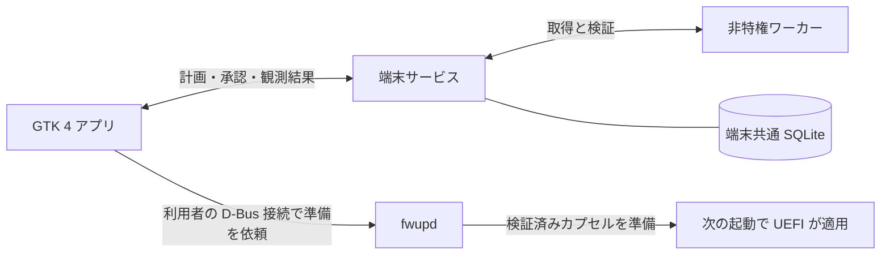

# BIOS 更新アプリ 基本設計

この PC のシステム BIOS／UEFI を更新する Linux デスクトップアプリ。開くと、機種、現在の BIOS 版、次に選べる操作が一画面にそろう。更新の予約、再起動の延期、次回ログイン後の結果確認も同じ画面で行う。

初版の設計対象は Ubuntu 24.04 LTS と Linux Mint 22 系をインストールした x86_64 の UEFI 機。対応を公表する単位は、機種・基板リビジョン、カプセルの配送方式、試験した OS と fwupd の組み合わせとする。GUI の実装言語は C17、ツールキットは GTK 4、配布形式は `.deb`。同梱の Python とシェルは CLI サンプルである。機種判定・配送・障害復旧の判定規則は既存の詳細設計に従う。[詳細設計 第1–6節](../../../mknk-bios-update-design-and-sample/Linux-BIOS-Updater-Design.md)

## 主画面

上段は「この PC」、中央は更新の状態と理由、その直下は次に選べる操作。承認内容や履歴を開いても機種と現在版は同じ位置にある。以下の機種、版、日時、変更内容は架空の表示例である。

```text
BIOS 更新                                         ［履歴］

開発用ノート NB-14
現在の BIOS          1.20

この機種に適用できる更新があります
更新候補             1.24
配布元               LVFS 安定版
確認日時             11月21日 10時32分
変更内容             スリープ復帰時の画面表示を修正

［更新する］    ［配布情報を再確認］
```

候補にはメーカーが Linux 向けに更新を配布するサービス（LVFS）の安定版、または照会した管理者指定ミラーの名称を添える。署名日時と確認できた上流同期時点は詳細で読める。通信できないときも、ローカルで取得できた現在版を示し、保存済みの候補には「前回確認」と日時を付ける。読み取れない値には「確認できません」と表示する。[LVFS の概要](https://lvfs.readthedocs.io/en/latest/intro.html)

「更新する」を押すと、配布ファイルを取得・検証する。完了すると中央に**承認欄**が開く。現在版 → 目標版、対象部品、配布元、変更内容、必要な起動操作を並べる。メーカー一体更新は確認できた内訳を添える。中間版が必要なら、今回承認できる段階を版ごとに示す。事前に検証できた後続版は承認範囲に含められる。中間版の導入後に初めて照合できる後続版には「予定・未承認」と表示する。計画 ID と CAB（配布ファイル）のハッシュは詳細で読める。暗号化に影響する可能性がある場合は、別端末や紙で回復手段を参照できるかをここで確認する。

承認欄の操作は「今回は見送る」と「この更新を承認」。見送れば新規の予約は 0 件。承認から送信までに対象や配布物が変わった場合は、変更点を示して新しい内容で承認を受ける。

**予約後の表示例**では、上段に「現在の BIOS　1.20」、中央に「1.24 を予約済み」を表示する。「起動条件を確認」で予約・起動先・給電を読み直し、通常の OS メニューから再起動する手順を示す。電源オフが必要な機種には、メニューで電源を切り、次に電源を入れる手順を示す。「あとで」を選んでも予約は保持される。

## 画面に出す状態と操作

起動・再ログイン時は端末の未解決操作と未完了の計画を読み、実機の版・予約を照合して主画面を組み立てる。「状態を再確認」は実機・予約・履歴の読み直し、「配布情報を再確認」は配布元の再照会とする。

| 観測した状態 | 利用者に示す内容 | 選べる操作 |
| --- | --- | --- |
| 初回照会／適合する新版なし | 照会中は現在版と工程。機種掲載と候補を照合し、適合する新版、未判定の候補、優先して示すべき制限や進行中の更新がなければ「この配布元に適用可能な新版なし」 | 配布情報を再確認 |
| 機種を特定できない／配布元に未掲載／情報不足 | 「この機種の対応を確認できません」「配布情報を取得できません」など、判定が止まった理由 | 再確認。機種に対応する公式手順を特定できた場合はその手順を開く |
| 対象に一致する安定版あり | 現在版 → 候補版。既知の中間版や管理者の制限を併記 | 準備可能なら「更新する」。制限時は理由と解消方法を読む |
| 取得・検証中 → 承認待ち | 取得量、照合中の項目、確定した適用先。AC 電源、必要残量、起動区画の容量などが不足したらその項目を表示 | 承認前は見送れる。条件がそろえば「この更新を承認」 |
| 準備を依頼済み、受付または予約を照合中 | 「更新準備を受付済み」または「受付結果を確認できません」と、現在の実機版。応答が途切れても同じ操作を追跡 | 状態を再確認。自動再送は 0 回 |
| 承認した予約を確認 | 「再起動待ち」または「電源オフ待ち」と、給電などの条件不足を同じ場所に表示 | 「起動条件を確認」で再照合し、成立時はデスクトップのメニューで行う操作を案内する。延期は「あとで」 |
| 起動後、同一個体の目標版を確認 | 受付記録と実機版を別々に表示。対象版への新しい試行失敗がなく、確認対象の予約と進行中の処理の解消も確かめたら「目標版の導入を確認」 | 履歴を見る。次段階のある計画は承認範囲と継続条件を再照合 |
| 起動後、予約残存／新しい試行失敗／結果を特定できない | 現在版、確認できた予約や試行結果、不足項目を個別に示す。目標版でも新しい試行失敗があれば「作業者による確認が必要」 | 状態を再確認、機種別の復旧手順を開く。元の処理と予約の解消を確認できた場合に再計画 |

新規候補の表示より、既存の予約、結果の照合、未完了の計画を優先する。承認前に閉じた場合は次回に候補を再照合する。承認済みで準備前なら計画を復元し、送信許可が発行された後なら同じ操作の受付と予約を照合する。予約済みなら起動操作を、起動後なら観測した結果を中央に出す。通常のローカルアカウントで再ログイン後の承認者を確認できない場合は、後続の準備前に中央の欄で再承認を受ける。他の利用者が開いたときは閲覧から始める。

UEFI で書き込みが始まると、PC 本体が更新画面を表示する。次回ログイン時に Linux 側で観測を再開する。「履歴」を押すと主画面の下部が開き、各段階の時刻・対象版・受付・実機で確認した版と試行結果を読める。

## Linux 上の構成



- **識別と配布**　UEFI の ESRT（ファームウェア資源表）の `fw_type=1` と GUID を、fwupd の内蔵カプセル対応デバイスに照合する。確定した Device ID について、LVFS 安定版または管理者指定の安定版ミラーの署名済み情報と候補を突き合わせる。CAB 全体のハッシュ、同梱部品とカプセルの宛先まで検証し、独立した書き込み先がシステム BIOS 一つと確定した段階を承認に出す。[UEFI の ESRT 定義](https://uefi.org/specs/UEFI/2.11/23_Firmware_Update_and_Reporting.html#efi-system-resource-table) ・ [LVFS の適合条件](https://lvfs.readthedocs.io/en/latest/metainfo.html)
- **権限と記録**　GTK アプリは一般ユーザーで動き、`libfwupd` で非同期に照会する。端末サービスは保護された機器・予約情報を読み、計画、承認、段階ごとの送信許可と観測結果を SQLite に保存する。取得・検証は非特権ワーカーが担う。署名済みカタログの取り込みは詳細設計の送信担当が直列化する。[fwupd の候補照会 API](https://fwupd.github.io/libfwupd/method.Client.get_upgrades_async.html)
- **準備と適用**　送信直前に対象・配布物・給電・起動先・既存予約・実行セッションを再照合する。端末単位で送信許可を永続化した後、承認を受けた GUI が同じ接続で、特定した fwupd に対象 ID と検証済み CAB の不変なファイル記述子を一度渡す。認可は OS 標準の polkit、配置は fwupd が担当する。予約後はアプリで給電・予約・終了を妨げる作業を確認する。利用者は案内に従いデスクトップのメニューから操作する。[fwupd の Install インターフェース](https://github.com/fwupd/fwupd/blob/2.0.20/src/org.freedesktop.fwupd.xml#L422-L459) ・ [UEFI カプセルの配送](https://github.com/fwupd/fwupd/blob/2.0.20/plugins/uefi-capsule/README.md)

### GTK の表示と入力

`GtkApplicationWindow` に機種・現在版の欄を常設する。中央の `GtkStack` だけを照会、承認、準備、起動待ち、結果の各表示に切り替える。履歴は下部で展開する。機器の観測と配布照会にはそれぞれ照会番号と対象を持たせ、遅れて届いた旧候補で予約済みの表示を上書きするのを防ぐ。送信の応答は画面が閉じても元の操作 ID に対応付け、未着なら未確定の記録から照合する。[GTK の Stack](https://docs.gtk.org/gtk4/class.Stack.html)

進捗率はこの操作の取得量と総量を確認できる間だけ表示し、それ以外は「署名を確認中」などの工程名にする。承認欄を開くと「今回は見送る」に、起動操作を表示すると「あとで」に初期フォーカスを置く。Tab で操作をたどれ、読み上げで現在版・目標版・保留理由を識別できるようにする。文字を拡大した場合は版と操作を縦に並べる。[GTK のアクセシビリティ](https://docs.gtk.org/gtk4/section-accessibility.html)

ログイン時の自動起動は閲覧専用で、同じ主画面でローカルの「状態を再確認」を使える。承認が必要な場合は、ランチャーに用意する「更新計画を開く」操作を案内する。デスクトップエントリの `Exec` と `G_APPLICATION_NON_UNIQUE` で正規 GUI を新規に起動する。端末サービスはアクティブなローカル画面への直接の帰属を照合する。GNOME Shell などが GUI を systemd のユーザースコープから起動した場合は、logind が返すプロセス所有者・表示セッション・操作中のシートを照合する。その画面で明示的に「更新計画を開く」を選び、polkit の管理者認証を済ませてから配布情報の再確認や更新準備へ進む。閲覧専用の起動ではこのボタンを表示しない。起動経路を照合できない場合は、閲覧と保留理由を表示する。[デスクトップエントリのアクション](https://specifications.freedesktop.org/desktop-entry/latest/recognized-keys.html) ・ [GLib の起動フラグ](https://docs.gtk.org/gio/flags.ApplicationFlags.html)

## 受け入れ条件

| 場面 | 確認する結果 |
| --- | --- |
| 同じ PC で BIOS、SSD、UEFI dbx が列挙される | BIOS だけが候補に出る。CAB が独立した別の部品にも適用され得る場合はその旨を表示し、予約は 0 件 |
| 「更新する」から承認欄で「今回は見送る」を押す。続いて有効な計画を承認し、同じボタンを連打する | 見送った段階の `Install` は 0 回。承認後は端末全体でその段階の送信が最大 1 回 |
| 配布照会中に既存予約が見つかり、旧照会が後から終了する。ネットを切って開き直す | 予約と現在版を先に表示し、前回の候補には日時が付く。「更新する」は出ない |
| 予約後に「あとで」を選び、AC を外す。再接続して起動条件を確認し、確認結果の到着前後に再び給電状態を変える | 条件が成立した時点の操作案内を表示し、機器・給電の変更時に再確認を求める。アプリからの電源メソッド呼出と追加の `Install` は0回 |
| 準備依頼の応答を失って再ログインする。目標版だが新しい試行失敗があるケースも試す | 同じ操作を再送しない。後者は目標版と失敗を併記し、次段階の自動準備は 0 回 |
| 予約済みの PC で閉じて開き直し、通常の再起動後にも開く。別利用者での閲覧も試す | 同じ主画面の同じ欄が、機種・旧版・起動待ちから、機種・観測版・結果に切り替わる。閲覧による承認変更や電源要求は 0 回 |
| キーボードのみ、読み上げ、文字サイズ 200% で候補確認から延期まで進める | 機種・版・理由・操作が読み取れ、承認・電源操作にはそれぞれ意図したボタン操作が必要 |

UI の受け入れ試験では模擬の端末サービスと fwupd で応答順、通信断、予約・電源状態を再現する。実機試験は、署名済みの安定版と単一の BIOS 宛先を確認できる機種で行う。Ubuntu の GNOME と Mint の Cinnamon で、閲覧専用画面を開いたままランチャーから計画を開き、セッション照合と polkit 認可を通して予約できることを確かめる。延期、デスクトップの終了確認、次回起動後の版照合まで通った構成を対応表に載せる。具体的な対応型番はこの実機試験で確定する。配布ビルドの基準は既存設計と同じ fwupd 2.0.20 とする。[Ubuntu の fwupd パッケージ](https://packages.ubuntu.com/en/noble-updates/fwupd)
