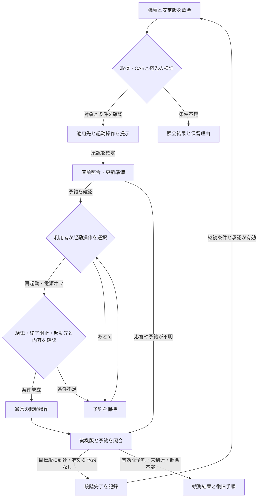

# Linux BIOS自動更新アプリ 設計書

2026年11月20日 · v0.7

## 1. 目的と対象

Linuxを起動したPCでアプリを開くと、機種・現在のBIOS版・適用可能な安定版を自動で調べる。「更新する」で候補を取得・検証し、確定した適用先と手順を表示する。「この更新を承認」の後に適用を準備する。標準設定では再起動のタイミングを利用者が選び、次回起動後に実機の版と結果を照合する。

初版の対象は、Ubuntu 24.04 LTSまたはLinux Mint 22系をインストールしたx86_64のUEFI実機。更新対象は、`fwupd` のUEFIカプセル更新に対応し、カプセルと起動経路から独立した書き込み先を1件に確定できるシステムBIOS／UEFI本体とする。メーカーがそのBIOS資源と一体で適用するEC等は、実行前にメーカーが公開している構成を表示する。単一の資源への一体更新であることを確認でき、内訳だけが非公開の場合は「メーカー一体更新・内訳非公開」と表示する。 [Ubuntuのfwupdパッケージ](https://packages.ubuntu.com/en/noble-updates/fwupd) ・ [fwupdのUEFIカプセル実装](https://github.com/fwupd/fwupd/tree/2.0.20/plugins/uefi-capsule) ・ [UEFI 2.11のESRT](https://uefi.org/specs/UEFI/2.11/23_Firmware_Update_and_Reporting.html#efi-system-resource-table)

## 2. 機種と書き込み先の照合

| 判定 | 使う情報 | 判定ルール |
| --- | --- | --- |
| 機種の表示 | LinuxのSMBIOS/DMI。メーカー、製品名、製品SKU、基板名・基板リビジョン、表示用BIOS版 | 完成品PCは製品名を優先し、自作機は基板名とリビジョンを表示。識別が不足する場合は取得できた項目を表示 |
| BIOS本体の特定 | システムサービスが読み取るESRTの `fw_type` と `fw_class`。`fwupd` の `GetDevices` が返すGUID、Device ID、`CompositeId`、プロトコル、更新可否 | `fw_type=1` のGUIDと一意に一致する内部のUEFIカプセル更新デバイスを選ぶ。複数の対象が候補に残る場合は保留 |
| 更新物の適合 | 選んだDevice IDに対する `fwupd` の判定。署名付き配布情報に含まれるGUID、メーカー識別子、CHIDや前提版など、配布側が指定する要件 | 当該実機が配布側の要件を満たす。基板リビジョンなどが必須の機種は、その条件も照合 |
| 承認したPC個体の照合 | システムサービスが固定のSMBIOS属性から取得するSystem UUIDと、機種の判定規則で必要な個体識別属性 | 承認時の値と再開時の値を同じ規則で照合する。一致、不一致、確認不能を区別し、第4・5節の継続条件に使う |

`/sys/class/dmi/id/` の情報は画面表示とメーカーサイトへの案内に使う。書き込みの宛先には `fwupd` の完全なDevice IDを渡し、ESRTのシステムファームウェアGUIDで裏付ける。CABの部品ごとの適用先は第4節で確認する。 [UEFI仕様のESRT](https://uefi.org/specs/UEFI/2.11/23_Firmware_Update_and_Reporting.html#efi-system-resource-table) ・ [LVFSの機種・バージョン要件](https://lvfs.readthedocs.io/en/latest/metainfo.html)

ESRTの主要属性はLinuxの標準権限で `0400`。`.deb` に組み込むシステムD-Busサービスが、`/sys/firmware/efi/esrt/entries/` にある既定の属性を読み、システムファームウェアの `fw_class`、`fw_type`、`fw_version`、`last_attempt_version`、`last_attempt_status` を型付きの値で返す。試行結果の取得可否も返し、欠落を成功値の `0` に置き換えない。このサービスは第4節の起動予約の照合と、第5節の端末単位の更新記録も担当する。機器情報の読み取りはアクティブなローカルセッションに限り、追加の対話認証を求めない。GUIは通常のユーザー権限で動く。 [Linux v6.8のESRT属性定義](https://github.com/torvalds/linux/blob/v6.8/drivers/firmware/efi/esrt.c#L117-L133) ・ [polkitのローカルセッション向け認可](https://www.freedesktop.org/software/polkit/docs/latest/polkit.8.html)

個体照合は、対象機種で個体ごとに付与されると確認できたSystem UUIDを、サービスが固定の `/sys/class/dmi/id/product_uuid` から読む。機種によってはメーカー資料または対象機種の検証で根拠が確認できる個体識別属性を組み合わせる。空、全0、全F、既定値、既知の重複、取得不能は確認不能とする。サービス内で正規化し、アプリ専用の鍵と規則の版を使った照合値だけを計画・操作記録に保存する。画面・ログ・送信情報には照合結果だけを出す。Device ID、GUID、`CompositeId` は書き込み先の照合に使い、起動ID・OSのmachine-id・ESPの区画IDはそれぞれの用途に使う。個体照合の根拠が不足する機種では、現起動で利用者が承認した単一段階を扱い、次の起動では第5節の手順で現況確認と再承認へ進む。 [SMBIOSのSystem Information](https://www.dmtf.org/sites/default/files/standards/documents/DSP0134_3.0.0.pdf) ・ [LinuxのDMI属性](https://github.com/torvalds/linux/blob/v6.8/drivers/firmware/dmi-id.c#L45-L56) ・ [fwupdのLinux ESRT上のID](https://github.com/fwupd/fwupd/blob/2.0.20/plugins/uefi-capsule/fu-uefi-capsule-backend-linux.c#L80-L84)

サービスや読取権限の問題は「機種照合情報にアクセスできません」、ESRTの対象項目が存在しない場合や旧式起動・仮想マシンなど初版の対象外では「この環境では自動更新に対応していません」と表示する。取得できた識別情報を保持し、適用先が一致しない場合はその理由を表示する。

## 3. 最新版の選び方

### 安定版の配布元と署名世代

1. 配布元はディストリビューションのLVFS安定版か、管理者が明示したその安定版ミラーとする。管理者は `GetRemotes` にあるリモートIDと許可するメタデータURIを組で指定できる。別IDを使う場合、照会・取り込み・候補の照合にそのIDを通して使う。有効化されていることを確認し、既定の配布元もIDと安定版URIの両方で特定する。安定版とテスト版でCABのURLが重なる場合があるため、配布物の出所はリモートへの結び付けと署名付きカタログ上の項目で判定する。CDNと同じ安定版のミラーは、リモートIDやホストが変わっても署名世代の比較では同じ配布元として扱う。 [安定版リモート](https://github.com/fwupd/fwupd/blob/2.0.20/data/remotes.d/lvfs.conf) ・ [テスト版リモート](https://github.com/fwupd/fwupd/blob/2.0.20/data/remotes.d/lvfs-testing.conf) ・ [LVFSのミラー設定](https://lvfs.readthedocs.io/en/latest/offline.html#using-a-helper-script)
2. 第5節の取得・検証プロセスは、選択したリモートの同じ設定版から、実際の取得先を組み立てる。署名は `fwupd_remote_build_metadata_sig_uri()`、圧縮XMLは `fwupd_remote_load_signature_bytes()` で署名ファイルに記載された本体名を反映した後に `fwupd_remote_build_metadata_uri()`、CABは認証済みリリースの場所から `fwupd_remote_build_firmware_uri()` を使う。設定値のURIだけで取得先を決めず、認証用パスやファイル名の置換を反映する。署名ファイルが示した本体名から通信する前に、構成後の取得先を許可範囲と照合する。本文と署名の真正性は第3項で検証する。 [fwupdのリモートURIと認証用パス](https://github.com/fwupd/fwupd/blob/2.0.20/libfwupd/fwupd-remote.c#L512-L561) ・ [リソース別のURI生成](https://github.com/fwupd/fwupd/blob/2.0.20/libfwupd/fwupd-remote.c#L1355-L1436) ・ [実際の取り込み経路](https://github.com/fwupd/fwupd/blob/2.0.20/libfwupd/fwupd-client.c#L4518-L4610)

   署名・XML・CABの最初の通信と各リダイレクトで、実際のスキーム・ホスト・ポート・パスをリソースごとの管理者許可と照合する。認証付きミラーの資格情報は許可されたHTTPSの認証先に限って添付する。別の許可済み配布先に移る場合も、前の接続の認証ヘッダ・URIの資格情報・秘密のクエリを継承しない。行き先自身に明示設定がある場合にだけ、その行き先用の資格情報を使う。適合しない転送先へは通信せず、秘密のないリモート名・ID、設定版、照合結果だけを画面・DB・ログへ渡す。取得経路は認証付きと匿名の実機配布ビルドで検証する。 [ミラーの認証設定](https://github.com/fwupd/fwupd/blob/2.0.20/docs/fwupd-remotes.d.md#L109-L119)
3. 共有キャッシュに渡す前に、実行中のOS版 `fwupd` と同じ信頼設定で、圧縮XMLと署名ファイルの組をlibjcatで検証する。受信した圧縮バイト列のチェックサムと信頼済み署名を確認し、検証済み署名結果の最大時刻、圧縮方式、圧縮物のSHA-256と署名ファイルのSHA-256を記録する。信頼設定・署名時刻を確認できない組や時刻0は保留する。検証後、対応するXZまたはZstandardを非特権プロセスで上限付きで展開し、XMLの展開バイト列そのもののSHA-256を計算する。展開失敗・未対応形式は保留する。既存キャッシュは、同じ安定版配布元の来歴と現在の信頼設定での検証が成立する場合に比較基準に加える。 [fwupdの信頼鍵](https://github.com/fwupd/fwupd/blob/2.0.20/src/fu-engine.c#L9338-L9348) ・ [署名結果の時刻](https://github.com/fwupd/fwupd/blob/2.0.20/src/fu-engine.c#L4538-L4569) ・ [LVFSの配布形式](https://lvfs.readthedocs.io/en/latest/offline.html#using-a-helper-script)
4. 同じ安定版配布元の最大確認済み署名時刻と、その時刻で確認した展開XMLのハッシュを、比較と同じトランザクションで端末共通DBに保存する。新しい署名時刻は記録を進める。同じか古い時刻で、最大時刻に対応する展開本文と完全に一致する検証済みの組は、同内容の表現として扱い、最大時刻を維持する。同じか古い時刻で本文が異なる組は保留する。公開番号、圧縮方式、取得時刻だけで同一性を決めない。圧縮ハッシュだけの旧記録から移す場合は、当時のハッシュと時刻に一致する信頼済みの組から展開ハッシュを求める。それができるまでは旧基準を保持し、より新しい署名世代を検証できれば新基準を記録する。キャッシュ欠損やミラー切替時も基準を保持する。初回は確認できた範囲を表示し、破損した基準を回復できない場合は保留する。
5. 同じ組を取り込む必要がなければ、読み取り照合で照会を再開する。配布先から今回取得・検証した本文に対し、現在の有効なリモートIDと設定で実在するキャッシュの本体・署名を再検証し、第4項の基準と展開本文が一致することを確認する。索引は `GetUpgrades`・`GetReleases` で、当該リモートのコンポーネント・版・CABハッシュを確認する。該当候補がないときは、認証済みXMLの既知コンポーネントを `fwupd_client_search_async()` で探し、その先頭リリースから当該リモートの索引が読まれたことを確認する。いずれも下記の機種別判定まで行う。同じ内容を認証する圧縮形式や署名バイト列の違いを許容する。設定、キャッシュの各ハッシュ、世代記録、デーモンの所有者が照会の前後で一致することを確かめる。必要な照合が済めば、取り込み応答が未確定でも確認した版と照会時刻を表示できる。未確定の取り込みが残る間は新規準備を保留する。配布先から今回の内容を確認できない場合は、前回の確認結果と日時を表示する。別IDへ切り替えた場合は切替先のキャッシュと索引で照合する。 [fwupdの索引検索](https://github.com/fwupd/fwupd/blob/2.0.20/src/fu-engine.c#L5833-L5861) ・ [検索時のリリース選択](https://github.com/fwupd/fwupd/blob/2.0.20/src/fu-release.c#L958-L978)
6. キャッシュが欠損・不一致、または索引に必要な内容が見えない場合は、第5節の送信担当が、検証した圧縮XMLと署名のバイト列をそのまま `UpdateMetadata` に渡せるか判定する。正常応答や `FWUPD_ERROR_NOTHING_TO_DO` を受けた場合も、第5項のキャッシュと索引の照合を行う。fwupdが同時刻や古い署名を理由に新形式を取り込まない場合、同じリモートの現行キャッシュと索引で第5項を満たせば照会できる。照合できなければ取り込みの結果と保留理由を示す。fwupdの署名時刻の比較や信頼設定を維持し、準備済みの更新は結果の照合を続ける。 [fwupdの時刻比較と索引の更新](https://github.com/fwupd/fwupd/blob/2.0.20/src/fu-engine.c#L4689-L4798)

### 対象機種の候補判定

1. GUIは、実装済みの操作に対応する機能だけを `fwupd_client_set_feature_flags_async()` で登録し、同じシステムバス接続で候補を照会する。接続の変更やデーモンの再起動後には登録し直す。この初版は現行ブランチ内を対象とし、ブランチ切替機能を広告しない。署名メタデータの `<requires><client>` を吟味し、意味が分かる必須機能を提供していない場合は、必要な機能と対応する更新方法を示す。fwupd 2.0.20が認識する機能名について、`|` で連結された要求はすべて確認し、デーモン側の能力とGUI側の機能を区別する。未知の要求や他の適合条件が未確認の場合は、その範囲を保留とする。 [機能を登録するAPI](https://fwupd.github.io/libfwupd/method.Client.set_feature_flags_async.html) ・ [要求の判定](https://github.com/fwupd/fwupd/blob/2.0.20/src/fu-engine-requirements.c#L767-L803)
2. 対象Device IDの `fwupd_client_get_upgrades_async()` のうち、第3節で検証した安定版リモートIDと一致する候補だけを採る。コンポーネント、現行ブランチ、版、CAB全体のハッシュを認証済みXMLと照合する。版は機器の `VersionFormat` と配布版の変換規則に従って比較する。署名XMLに記載された版の原文、版形式、比較・表示に使う版を区別する。ESRTの目標生値は署名付き資料や検証済み形式で一意に特定できた場合だけ持つ。CABの比較には同じハッシュ方式を使い、方式が異なる場合は同じCABのバイト列に両方式を適用する。 [候補取得API](https://fwupd.github.io/libfwupd/method.Client.get_upgrades_async.html) ・ [リモートID取得API](https://fwupd.github.io/libfwupd/method.Release.get_remote_id.html) ・ [デバイスに応じた版変換](https://github.com/fwupd/fwupd/blob/2.0.20/src/fu-release.c#L340-L363) ・ [Dell等の版形式](https://github.com/fwupd/fwupd/blob/2.0.20/plugins/uefi-capsule/README.md#L52-L87)
3. 候補の件数にかかわらず、認証済みXMLから実機の対象GUIDに該当し得る現行ブランチのリリースを調べる。最上位候補より上にある版、同版でCABハッシュが異なる項目、候補なしの場合は現在版より上の版を照合する。別SKUなど署名付きの機種要件、確認できた中間版・GUI機能の要件、正確なハッシュに対する管理者ポリシー等で、対象外になる理由を判定する。該当し得る上位版の除外理由が分からない場合や、同版で適合し得る別CABが残る場合は、下位版の最新版表示と送信を保留する。候補取得の前後と送信直前に、配布設定、共有キャッシュの両ハッシュ、検証済み世代、デーモンの所有者と対象候補を照合し、変化時は照会し直す。新規準備には、同じ安定版配布元の取り込みが未確定でないことも必要。
4. 管理者ポリシーは、`GetReleases` から同じ安定版のコンポーネント・版・CABを照合し、`BLOCKED_APPROVAL`、リモートの `APPROVAL_REQUIRED`、`GetApprovedFirmware` と `GetBlockedFirmware` を使って診断する。明示ブロックを優先し、未承認と確認できれば承認待ちと表示する。上位版が制限されている場合は、その版と制限を表示する。別SKU等を除外でき、残った適合候補がある場合は、適用可能な範囲での最新版を表示できる。重複排除・権限・通信等で除外理由を確定できない場合は保留する。 [承認フラグ](https://github.com/fwupd/fwupd/blob/2.0.20/src/fu-engine.c#L5641-L5654) ・ [GetReleasesの重複排除](https://github.com/fwupd/fwupd/blob/2.0.20/src/fu-engine.c#L5880-L5945) ・ [管理者ポリシーのAPI](https://github.com/fwupd/fwupd/blob/2.0.20/src/org.freedesktop.fwupd.xml)
5. 機器の待機、更新可否、前提版を確認する。最終版Cに中間版Bが必要だと公式情報で確認できた場合は、Bと適用順を計画に入れ、Bを「中間版」と表示する。Bの取得または適合が不明なら「必要な中間版を確認できません」と表示する。`NOTHING_TO_DO` は再起動待ちや版の明示指定が必要なときにも返る。同じ起動中にこのアプリが準備するのは、独立した書き込み先を1件に確定した段階1つ。適用先と版を確定できた段階を承認し、前段完了後の処理は第4・5節に従う。 [fwupd 2.0.20の候補判定](https://github.com/fwupd/fwupd/blob/2.0.20/src/fu-engine.c#L6194-L6304)

### 配布元で確認できる範囲

配布元名は今回照会した公開LVFS安定版または管理者指定ミラーの表示名とする。照会日時は本文・キャッシュ・索引と機種別判定を今回照合した日時、署名日時は照会対象の本文を認証した署名の時刻とする。上流との同期時点は、同じ本文との対応を管理者が信頼できる同期記録等で確認できる場合に別欄で表示する。ミラーの上流同期が不明ならその旨を表示し、照合済みのミラーの範囲では照会と適用を続けられる。同期時点の表示で、第3節の最大確認済み世代や公開範囲を広げない。前回結果を表示する場合は、当時の配布元と確認日時を保持する。 [LVFSのミラーとオフライン同期](https://lvfs.readthedocs.io/en/latest/offline.html#using-pulp-server)

機種の掲載は、今回照合した安定版本文、リモートID、機種・ブランチ・コンポーネントおよび署名付きの機種要件から判定する。現行版や過去版も版形式に従って照合する。別コンポーネントで索引の読取が確認できても、当該機種の掲載は別に判定する。テスト版の項目やfwupdの一般的な `SUPPORTED` は当該配布元での掲載の根拠に使わない。「新版なし」の判定より、適用できる候補、既知の制限や未判定候補、途中の更新状態を先に評価する。 [fwupdの機器対応フラグ](https://github.com/fwupd/fwupd/blob/2.0.20/src/fu-engine.c#L4226-L4243)

| 確認結果 | 表示と動作 |
| --- | --- |
| 今回照合した安定版カタログで対象機種の最上位適合版を確認 | 「〈配布元名〉で確認した適用可能な最新版」と現在版・目標版、照会日時を表示。準備できる場合は「更新する」を有効化 |
| 今回照合した安定版カタログに当該機種の現行版または過去版があり、適合する新版・未確定の上位候補・表示すべき制限が残っていない | 「〈配布元名〉に適用可能な新版なし」と表示し、配布元と照会日時を示す |
| 安定版の新版が管理者の承認待ち、または明示的にブロックされている | 版とともに「安定版あり・管理者の承認待ち」または「管理者が適用を制限」と表示し、その版の準備を保留 |
| 必要なクライアント機能を提供できない | 必須機能が特定できたら「この版にはブランチ切替に対応した更新ツールが必要」など理由を表示し、対応する更新方法を案内 |
| 安定版を取得できたが、適合可否・上位版の除外理由が未確定 | 「適用を許可された安定版候補を確認できません」。確認できた版と保留理由を表示 |
| 再起動・電源オフ待ち、版の明示指定、電源条件や既知の前提版が不足 | 「再起動待ち」「中間版が必要」などを表示し、条件を満たしたら再照会 |
| 最大確認済み時刻以下で、その時刻に対応する本文と異なるカタログを受信 | 「配布情報の世代を確認できません」。最後に確認した世代と照会日時を示し、新規準備を保留 |
| カタログの取り込み結果が未確定だが、今回の取得・キャッシュ・機種別照合が成立 | 確認した版と日時に「カタログの取り込み結果を確認中」を添え、新規準備を保留 |
| 配布元が未設定・無効、通信、署名検証、カタログ取得・取り込み・照合のいずれかに失敗 | 現在版と「配布情報を確認できません」を表示。判明した理由と前回確認した版・日時を示す |
| 今回の安定版カタログで当該機種の掲載を確認できない | 「〈配布元名〉でこの機種の対応を確認できません」。照会日時を示し、機種を確定できればメーカーの製品サポートを表示 |
| 機種の掲載を確認したが、この環境のLinuxからの適用に対応していない | 確認できた版と適用できない理由を表示し、確認済みの機種別手順を案内 |
| メーカー公式カタログで今回の配布元の候補より新しい安定版を確認 | メーカー版と、今回の配布元・候補版を表示し、初版では公式手順を案内する。メーカー版が確認できた時点で、その前提版を除き古い候補への更新を保留する |

初版の自動適用はLVFSを使う。対応機種の公式手順として、Dellの起動メニューのBIOS Flash Update、ASUSマザーボードのEZ Flash 3などへ案内できる。機種と対応手順の両方を確認できた場合に表示する。 [DellのLinux向け更新手順](https://www.dell.com/support/kbdoc/en-us/000131486/update-the-dell-bios-in-a-linux-or-ubuntu-environment) ・ [ASUS EZ Flash 3](https://www.asus.com/jp/support/faq/1012815/)

メーカー版の自動照合は、公式の機種別カタログと機種IDの対応表を検証できたメーカーから追加する。たとえばDell商用PCの公式カタログはプラットフォーム別に公開されている。機種ID、対象リビジョン、安定版区分、版表記の対応が確定したものを照合する。自動適用に進めるのは、メーカーが明示したLinux対応方式で、適合・署名・結果を確認するアダプターが検証できた機種。 [Dellの商用PC用公式カタログ](https://www.dell.com/support/kbdoc/en-us/000453493/dell-client-commercial-pcs-update-catalog-cadences)

## 4. 画面と更新の流れ

主画面に機種名、現在の版、更新先の版、今回の配布元と第3節の各確認時点、変更内容、適用する部品、更新に必要な操作を表示する。「更新する」で取得と読取検証を開始し、確認画面に「この更新を承認」を出す。準備後は「再起動する」「電源を切る」「あとで」を状態に応じて出す。中間版の準備後にも「後続の更新を中止」を選べる。UEFIでの書き込み中は、進捗表示をPC本体の更新画面に引き継ぐ。

### CABの検証と適用範囲の確定

`fwupd` 2.0.20の `Install` は、指定したDevice IDと同じ `CompositeId` の実機デバイス群を、CAB内の全コンポーネントと照合する。`INSTALL_ALL_RELEASES` の対象では一つのコンポーネントの複数版が処理され得る。`GetDetails` が表示するのは各コンポーネントの先頭リリースに基づく情報である。 [Installの実装](https://github.com/fwupd/fwupd/blob/2.0.20/src/fu-dbus-daemon.c#L862-L1010) ・ [GetDetailsの実装](https://github.com/fwupd/fwupd/blob/2.0.20/src/fu-engine.c#L4918-L5004)

1. 署名付き配布情報にあるCAB全体のSHA-256またはSHA-512で、取得したバイト列を検証する。検証済みCABの全ファームウェアコンポーネント、対象GUID、全リリースとペイロードの対応を読み取る。CABとAppStreamメタデータの解析は一般ユーザー権限で行い、扱える形式を試験済みのものに限定する。 [LVFSの配布メタデータ](https://lvfs.readthedocs.io/en/latest/metainfo.html)
2. 指定デバイスと同じ `CompositeId` の全候補に、各コンポーネントの対象GUIDを照合する。通常の対象では先頭リリースを、`INSTALL_ALL_RELEASES` が有効になり得る対象では全リリースを数え、適用され得るDevice ID・コンポーネント・版の組が計画上の1件と一致することを確認する。追加候補を除外できる根拠がなければ適用範囲に数える。`fwupd_client_get_details_bytes_async()` はメーカー情報・機種・版の追加照合に使う。別の独立部品や複数の適用版が残る場合や、CABの解釈を確定できない場合は理由を表示してメーカー手順へ案内する。 [CABの詳細を取得するAPI](https://fwupd.github.io/libfwupd/method.Client.get_details_bytes_async.html)
3. 対象を1件に絞ったCABでも、実際に配送されるカプセルの形式を確認する。`fwupd` の対応ビルドが行うヘッダー補正とメーカー形式を考慮し、ESRT GUIDの外装に入った標準FMP（Firmware Management Protocol）も判定に含める。FMPは全画像を列挙し、各 `UpdateImageTypeId`、`UpdateImageIndex`、`UpdateHardwareInstance` から実機で適用され得る宛先と回数を求める。インスタンス指定のない画像は、機種・基板リビジョン・ファームウェア構成の確認記録から合致先が1件に限られる場合のみ対象にする。LinuxのESRT GUIDは照合に使えるが、それだけでFMPの画像インデックスやインスタンスは確定できない。独立した別宛先、同じ宛先への複数適用、埋め込みドライバー、実機での解釈が分からない形式・入れ子が残れば保留する。 [UEFI 2.11のFMPカプセル処理](https://uefi.org/specs/UEFI/2.11/23_Firmware_Update_and_Reporting.html#firmware-processing-of-the-capsule-identified-by-efi-firmware-management-capsule-id-guid) ・ [fwupdのヘッダー補正](https://github.com/fwupd/fwupd/blob/2.0.20/plugins/uefi-capsule/fu-uefi-capsule-device.c#L372-L431) ・ [EDK IIの入れ子と画像の処理](https://github.com/tianocore/edk2/blob/edk2-stable202511/MdeModulePkg/Library/DxeCapsuleLibFmp/DxeCapsuleLib.c#L1232-L1347)
4. 非FMPのメーカー形式は、メーカー資料または対応機種の読取・適用検証により、独立した配布先が承認対象のBIOS資源1件と確認できる形式を扱う。内訳のみが非公開のメーカー一体更新は、第1節のとおり表示できる。対応情報には機種・基板リビジョン・ESRT GUID・対象ファームウェア範囲・方式・対応OSビルド・判定根拠を持つ。カプセル形式や宛先の判定は一般ユーザー権限で行う。
5. `Install` には具体的なDevice ID、元CABの記述子、更新オプションを渡す。`CompositeId` は公開アクセサの実効値を使い、CAB・カプセルおよび固定内蔵構成から書き込み先を1件に確定する。対応するfwupdビルドと配送方式の変換規則を検証し、承認対象のペイロードから配置されるBIOSカプセルの全バイト列に対するSHA-256を準備前に求める。ヘッダー補正や外装の追加を含める。CAB全体のハッシュと対応する区画・パス・カプセルのハッシュを計画の段階に一体で記録する。準備直前には、機器・構成・現在版、CABとカプセルの判定根拠、配布元と上位版、管理者のCAB配布承認、給電、起動経路と既存予約、他の更新の進行を再確認する。カプセルとの対応が求まらない場合は準備を保留し、対象や承認内容が変わった場合は計画を作り直す。 [InstallのD-Busインターフェース](https://github.com/fwupd/fwupd/blob/2.0.20/src/org.freedesktop.fwupd.xml#L416-L462) ・ [fwupdのカプセル変換](https://github.com/fwupd/fwupd/blob/2.0.20/plugins/uefi-capsule/fu-uefi-capsule-device.c#L372-L431)

### 準備開始と起動後の処理

| 時点 | 処理 |
| --- | --- |
| 取得・読取検証 | 「更新する」で承認対象のリリースを取得・検証し、適用先、版、部品、順序と起動操作を確定する。`Install` は0回。対象の物理区画、起動経路とローダー、既存予約、給電条件を調べ、必要な回復手段を案内する |
| 承認時 | 画面に提示できた段階について「この更新を承認」で承認を取得する。計画ID、PC個体の照合値または現起動内に限る承認、利用者と承認範囲を保存する。段階にはDevice ID、ESRT GUID、`CompositeId`、AppStreamコンポーネントID、版形式・現在版と目標版、ブランチ、配布元ID、CABと配置後カプセルそれぞれのハッシュ、変換規則、配送方式と対象物理区画・パス、書き込み先と起動操作を記録する。B導入後に初めてCの適合や内容を確定できる場合、Cは未承認の予定として表示する |
| 準備直前 | 承認と対象、AC接続、最低充電量、方式に応じたESP空き容量、接続中の物理区画・起動先・ローダー、他の更新と既存予約を照合する。操作枠を確保し、第5節の送信許可を永続化する。実行者のGUIが、照合済みの一意名へ検証済みの元CABと具体的なDevice IDで `Install` を1回送る。署名・適合の最終検査と配置はfwupdが行う |
| 応答を受領 | 正常応答を受けたら「更新準備を受付済み」と記録する。エラー、応答欠落、記録失敗でも、送信できる状態に達していれば実機と予約を照合する。未解決の段階操作がある間は新規送信を保留する |
| 起動予約を確認 | 承認したBIOSと一致する予約を照合できれば必要な起動操作を表示する。`NEEDS_SHUTDOWN` があれば電源オフを選ぶ。アプリは下記の直前確認を満たすときに起動操作を要求する。「あとで」は予約を保持し、次の該当する起動で適用されることと、書き込み中の電源維持を伝える |
| 次回ログイン・通常起動 | 現在のPCの未解決操作と終了していない全計画を別々に取得し、個体照合と計画の状態に応じて表示する。初回の準備待ち、次段階の継続待ち、再承認待ちなど、操作枠のない計画も表示する。他の利用者が参照する場合も第5節の承認・引継ぎの条件を適用する |

適用の記録では、CABに対する管理者の配布承認の照合時点・対象ハッシュ、送信後に観測できたOSのpolkit認可・拒否と応答、予約の実体を区別する。送信前に配布承認の失効を検知した場合は送信を保留する。送信後に失効を検知した場合は、配布承認の変更と先の操作の確認状況を表示し、同じ操作枠で応答と予約を照合する。認証待ちで失効した場合も、すでに処理され得る操作として扱う。 [fwupdの配布承認](https://github.com/fwupd/fwupd/blob/2.0.20/src/fu-engine.c#L5639-L5655) ・ [fwupdの認可後の処理](https://github.com/fwupd/fwupd/blob/2.0.20/src/fu-dbus-daemon.c#L737-L781)

暗号化は、`AFFECTS_FDE` の有無に加え、UDisks2が公開するボリュームの形式と利用者が申告した構成で確認する。情報からTPMとの連携やBitLockerの保護状態を特定できない場合は確認できた範囲を表示する。影響が考えられる構成では、フラグの有無にかかわらず更新前に回復手段を案内する。UbuntuのTPM連携暗号化とWindows BitLockerを併用するPCでは、利用者が両方の回復手段を、対象PCが起動しなくても別端末や紙で参照できることを準備前に確認する。回復キーは利用者が保管し、アプリは回復キーを取得・記録・送信しない。Windows側の操作の要否は該当構成のメーカー／Microsoft資料で確認する。 [fwupdのフラグ処理](https://github.com/fwupd/fwupd/blob/2.0.20/src/fu-engine.c#L457-L467) ・ [UDisks2のボリューム情報](https://storaged.org/doc/udisks2-api/latest/gdbus-org.freedesktop.UDisks2.Block.html) ・ [MicrosoftのBitLockerガイド](https://learn.microsoft.com/ja-jp/windows/security/operating-system-security/data-protection/bitlocker/faq) ・ [systemdのTPM2とLUKSに関する資料](https://www.freedesktop.org/software/systemd/man/latest/systemd-cryptenroll.html) ・ [Ubuntu 24.04の回復キー](https://ubuntu.com/desktop/docs/en/24.04/explanation/hardware-backed-disk-encryption/#recovery-key)

### 電源操作の直前確認

アプリから通常の再起動・電源オフを要求するたびに、第4節の起動予約・起動先と、対象機種・配送方式に必要なAC接続・最低充電量を読み直す。「あとで」から戻る場合も毎回行う。対応機種の規則とOSの電源情報を使い、ACの接続状態と実機の給電に使うバッテリーを照合する。AC情報、残量の読み取りが不足、失敗、矛盾する場合は確認不能とする。バッテリーなしを確認できる機種では残量条件を省く。給電条件を満たさないときは「ACアダプターを接続してください」等の理由を表示し、予約を保持して起動要求を保留する。回復後は利用者の新しい操作で再確認する。 [UPowerの電源情報](https://upower.freedesktop.org/docs/Device.html) ・ [fwupdの電源条件](https://github.com/fwupd/fwupd/blob/2.0.20/src/fu-engine.c#L3002-L3037) ・ [DellのBIOS更新時の給電](https://www.dell.com/support/kbdoc/en-us/000124211/dell-bios-updates)

アクティブなローカル利用者の接続で、同じlogindの `CanReboot` または `CanPowerOff` と `ListInhibitors` を確認する。同じUIDも含め、`shutdown` のブロックがある場合、読取不能、操作権限不足の場合は、理由を表示して予約を保持する。有効な遅延ロックはOSの通常処理に委ねる。 [systemd 255のlogind API](https://www.freedesktop.org/software/systemd/man/255/org.freedesktop.login1.html)

| デスクトップ経路 | 電源操作の要求と終了確認 |
| --- | --- |
| 直接のlogind経路を検証済みの構成 | セッション側に有効な終了阻止がないことを対応するデスクトップで確認する。現在の操作可否が `yes` の場合は、確認済みのlogindに `RebootWithFlags(0)` または `PowerOffWithFlags(0)` を1回要求する。通常UEFI起動を通ることを確認した配布ビルドで使う |
| 検証済みのLinux Mint Cinnamon | 同じアクティブなセッションのCinnamon SessionManager（`org.gnome.SessionManager`）に `IsInhibited(1)` でログアウト阻止を問い合わせる。両方に有効な阻止がなくlogindの操作可否が `yes` の場合、同じセッションマネージャーの `RequestReboot` または `RequestShutdown` を1回呼ぶ。これらは終了時のアプリ照会を経て、Cinnamonの通常のlogind `Reboot` または `PowerOff` に進む。アプリはデスクトップによる取消を尊重する |
| セッション識別、終了阻止、または通常の起動経路を確認できない | 起動要求を保留し、予約と必要な操作を表示する。読取を再試行できる |

Cinnamonの経路は標準のシステムバックエンドとデスクトップの終了処理を検証した配布構成で使う。Cinnamon 6.2.1にはlogindの拒否時に旧MDMに終了処理を委ねる分岐がある。この版では有効な旧MDMの経路がないこともアプリの要求前に確認し、拒否でセッションだけが閉じた場合は次回ログインで予約を再照合する。確認できたlogindの実装が通常の再起動・電源オフを行うことを配布構成で検証する。Cinnamonの要求の応答は終了処理の受付として扱い、電源操作とBIOS適用はその後の観測で確認する。 [Cinnamonの名前と接続先](https://github.com/linuxmint/cinnamon-session/blob/6.2.1/cinnamon-session/csm-manager.c#L62-L63) ・ [標準の終了処理への要求](https://github.com/linuxmint/cinnamon-session/blob/6.2.1/cinnamon-session/csm-manager.c#L2322-L2368) ・ [logindへ渡す操作](https://github.com/linuxmint/cinnamon-session/blob/6.2.1/cinnamon-session/csm-systemd.c#L197-L249) ・ [旧MDMへの分岐](https://github.com/linuxmint/cinnamon-session/blob/6.2.1/cinnamon-session/csm-manager.c#L462-L506) ・ [旧MDMの接続判定](https://github.com/linuxmint/cinnamon-session/blob/6.2.1/cinnamon-session/mdm.c#L250-L263) ・ [logindの再起動方式](https://github.com/systemd/systemd-stable/blob/v255.4/src/login/logind-dbus.c#L1994-L2048)

セッション経由で要求する場合も、利用者の操作直前に給電・予約・配送先を読み直す。Cinnamonではアプリを通常のセッションクライアントとして登録し、アプリの要求に対する `QueryEndSession` でも観測を更新する。観測値に変化があれば、対象区画の一意性、承認内容との一致、給電と終了阻止を再判定する。AC接続を維持したまま残量が増えるなど、全条件が引き続き成立する場合は通常の終了応答を返す。条件が崩れた場合、または必要な再読取に失敗した場合は、理由を付けて `EndSessionResponse(false, 理由)` を返し、デスクトップに終了の保留を求める。未保存データを持つ他のアプリからこの段階で出た阻止も通常のデスクトップ終了処理で扱う。取消後は予約を保持し、再び条件を満たしたときの利用者の新しい操作で進める。アプリは強制終了や拒否後の別経路を要求しない。最後の観測より後の外部操作については、次回ログイン時に結果を照合する。 [Cinnamonのアプリへの終了問い合わせ](https://github.com/linuxmint/cinnamon-session/blob/6.2.1/cinnamon-session/csm-manager.c#L1455-L1480) ・ [クライアントの終了応答](https://github.com/linuxmint/cinnamon-session/blob/6.2.1/cinnamon-session/csm-dbus-client.c#L79-L90) ・ [終了阻止時の処理](https://github.com/linuxmint/cinnamon-session/blob/6.2.1/cinnamon-session/csm-manager.c#L1323-L1371) ・ [Cinnamonのlogindへの阻止引継ぎ](https://github.com/linuxmint/cinnamon-session/blob/6.2.1/cinnamon-session/csm-systemd.c#L614-L637)

電源操作はPC全体に及ぶため、操作の直前にlogindでログイン中の利用者セッションを列挙する。画面切替で非アクティブになった別のグラフィカルセッションも含める。他のデスクトップの未保存作業について、そのセッションの通常の終了確認を経られない場合は、アプリからの電源要求を保留する。利用者には別セッションで作業を保存してログアウトするよう案内する。予約を保持し、セッション一覧が変われば再取得する。ログイン画面やバックグラウンドのシステムサービスだけを理由に保留しない。 [logindのセッション一覧と属性](https://www.freedesktop.org/software/systemd/man/255/org.freedesktop.login1.html)

複数画面から同じ予約の電源操作を選んだ場合、端末サービスが起動ID・予約・操作種別・要求元接続を照合し、1件だけをSQLiteのトランザクションで受け付ける。要求元だけが最終確認後に1回送る。他の画面には「終了確認中」と表示する。送達前の取消、またはデスクトップによる取消・OSの拒否が確定した場合は、その要求を閉じて予約を保持する。応答喪失やGUI終了時には自動再送せず、元の接続が再送できず、終了処理も保留中の電源要求もないことをOSとデスクトップで確認できた場合に、利用者の新しい操作を受け付ける。判定不能なら予約と理由を表示する。新しいLinux起動では第4節の結果照合に進む。

### 起動予約の照合

`Install` は配置後にエラーを返すことがある。`fwupd` 2.0.20の `fwupd-efi` 経由ではカプセルと次回の起動先を登録し、その処理中の履歴を `SUCCESS` にした後で、OSの再起動通知を作る。この通知の作成に失敗すると `NEEDS_REBOOT` の記録前にエラーを返し得る。`NeedsReboot` デバイスフラグはUEFIカプセル機器の初期化時から付くため、実際の予約とは別の情報として扱う。 [カプセルの配置](https://github.com/fwupd/fwupd/blob/2.0.20/plugins/uefi-capsule/fu-uefi-nvram-device.c#L87-L136) ・ [途中の成功履歴](https://github.com/fwupd/fwupd/blob/2.0.20/src/fu-engine.c#L3839-L3853) ・ [通知と待機状態の記録順](https://github.com/fwupd/fwupd/blob/2.0.20/src/fu-engine.c#L2774-L2811) ・ [デバイスフラグの初期値](https://github.com/fwupd/fwupd/blob/2.0.20/plugins/uefi-capsule/fu-uefi-capsule-device.c#L790-L802)

システムサービスは送信前、応答後、アプリの起動操作要求前、次回起動後に、実機が使い得る配送経路を読み取る。配置先ESPはfwupdの有効設定と機種別規則から、ファームウェアや更新用ローダーが読むESPは実際のEFIデバイスパスとその解決規則から求める。履歴のない初回は、対応機種・配布ビルドで検証した規則、読み取れる設定と固定構成を使う。複数の有効経路があり得る場合は、関係する経路をすべて読めることと、承認した更新の配送先を特定できることが必要。確認済みの宛先でEFI変数や更新ディレクトリが未作成と分かれば空と扱う。権限不足、読取失敗、区画の取り違えは判定不能とする。 [fwupdのESP選択](https://github.com/fwupd/fwupd/blob/2.0.20/libfwupdplugin/fu-context.c#L1887-L1971) ・ [配送方式の選択](https://github.com/fwupd/fwupd/blob/2.0.20/plugins/uefi-capsule/fu-uefi-capsule-plugin.c#L989-L1101)

接続中の物理ディスクと区画を、未マウントの内蔵・外付け媒体を含めてOSのブロックデバイス情報から再取得する。同じ物理区画の別名・別マウントは1件として扱い、異なる物理媒体は同じ区画GUIDやバイト列でも別件とする。`HD()` の短縮パスはGPTの区画GUIDと区画番号など、該当方式の実際の照合キーで全候補を数える。フルパスでは接続デバイスまで解決し、更新用ローダーが行う代替探索にも同じ候補確認を適用する。配置先、更新用ローダーの区画、更新情報からBIOSファイルが解決される区画をそれぞれ確認する。必要な区画が一意で、記録した配置先とも一致する場合に限って準備またはアプリからの起動操作に進む。物理区画の追加・取外し、パスやマウントの変更を検知したら照合結果を破棄して読み直す。複製SSDなどで複数が一致した場合は理由を表示し、準備済みなら予約を保持する。 [UEFIの短縮パスと複数一致](https://uefi.org/specs/UEFI/2.11/03_Boot_Manager.html#load-option-processing) ・ [fwupdの区画とファイルのパス生成](https://github.com/fwupd/fwupd/blob/2.0.20/plugins/uefi-capsule/fu-uefi-capsule-device.c#L350-L368) ・ [fwupd-efiの代替探索](https://github.com/fwupd/fwupd-efi/blob/1.4/efi/fwupdate.c#L222-L272)

| 配送方式 | 照合する更新物と起動先 |
| --- | --- |
| NVRAM方式の `fwupd-efi` | `fwupd-efi` が列挙するEFI更新情報を別GUIDも含めて確認し、`ATTEMPT_UPDATE` と対象物理ESPのファイルを照合する。`BootNext` が未設定でも、今回のローダー起動で処理され得る既存登録を数える。既知の `ATTEMPTED` のみという記録は再実行を指示する記録と区別する。起動エントリと実際のローダーは下記の事前確認で特定する |
| 標準Capsule-on-Disk | 配置先と、`BootNext`・`BootOrder` と実際のEFIパスから決まる処理対象の物理ESPを照合する。更新ディレクトリの全候補を、現在の配送ビットが0でも確認する。処理対象と判断できないファイル、別GUIDと、下記の条件で確認できた前段の残存ファイルを区別する |
| メーカー独自のCapsule-on-Disk | 検証済みの配置・起動・ファイル処理規則で、今回の操作で対象に入る既存更新を確認する |
| 読めない・方法を特定できない | 「起動予約を確認できません」。確認できない経路と公式の機種別手順を表示 |

判定結果は、承認したBIOS資源の現在の予約（あり・確認した経路ではなし・判定不能）、今回の準備で有効になる既存更新（あり・なし・判定不能）、次回起動先で記録する。送信を許可するのは、対象に未解決の予約がなく、今回の準備で別の既存更新が有効にならず、起動先を確認できる場合。既存候補を有効にする、または判定不能なら理由を表示して保留する。応答後と起動要求直前は、対象物理ESPから読み取った実体のSHA-256を、CAB検証時に承認した配置後ハッシュと照合する。正しい予約登録・対象と内容がそろったときだけ、アプリからの起動操作に進める。名前やGUIDが同じでも、内容が不一致・読取不能・承認時の対応記録がない場合は、観測できた予約を表示して保持し、再起動または電源オフを保留する。 [fwupd-efiが列挙する更新](https://github.com/fwupd/fwupd-efi/blob/1.4/efi/fwupdate.c#L117-L178) ・ [NVRAM方式のBIOSファイル名と配置](https://github.com/fwupd/fwupd/blob/2.0.20/plugins/uefi-capsule/fu-uefi-nvram-device.c#L87-L115) ・ [標準CoDでの配置と配送ビット](https://github.com/fwupd/fwupd/blob/2.0.20/plugins/uefi-capsule/fu-uefi-cod-device.c#L265-L321)

配置後のハッシュを持たない旧計画は、記録済みの元CABと同じハッシュの検証済みCAB、および当時の方式と変換規則を確認できる場合に限り、配置後のハッシュを復元して実体と照合する。確認できない予約は保持し、未照合と表示する。

#### 更新用ローダーと既存の起動登録

送信前に、対応ビルドが使うファームウェア更新用EFIローダー、置き場所、必要なshimとロードオプションを解決する。Secure Bootの有効状態を確認し、有効な構成では実機と配布ビルドで確認したEFI実行ファイルの信頼・失効条件、対象ESPの既存shim、またはfwupdの配布物から配置できる適合shimを確認する。配布版のshim選択、既存ファイルの再利用とコピー、SBATなどの検査条件を使う。必要なローダーやshimが用意できない構成、信頼と配置の可否が不明な構成は、理由を表示して準備を保留する。検証済みの正規配布物から配置できる構成は準備できる。 [fwupdの配置順](https://github.com/fwupd/fwupd/blob/2.0.20/plugins/uefi-capsule/fu-uefi-nvram-device.c#L87-L133) ・ [更新用ローダーとshimの選択](https://github.com/fwupd/fwupd/blob/2.0.20/plugins/uefi-capsule/fu-uefi-bootmgr.c#L338-L444)

NVRAM方式では `BootNext` が未設定でも、対応fwupdビルドが表示名で再利用し得る永続的な `Boot####` を調べる。選ばれ得る登録について、OSと物理ESP、ローダーのパスと必要なロードオプションを、今回の配送経路と照合する。別OSを指す項目の再利用・上書きがあり得る構成は `Install` を保留する。適合する自OSの登録は再利用できる。新規登録の作成と既存の起動順への追加を行う規則がある場合は、予定の変更範囲も先に確認する。準備後は実際に選ばれる登録とローダーの実体を起動要求前に再照合する。 [既存起動エントリーの選択と再利用](https://github.com/fwupd/fwupd/blob/2.0.20/plugins/uefi-capsule/fu-uefi-bootmgr.c#L117-L218)

#### NVRAM経路の表示用カプセル

対応表で検証した `fwupd` と `fwupd-efi` のNVRAM方式では、更新画面の画像を載せる表示用カプセルがBIOS本体に付随する場合がある。送信前に実行待ちの表示登録がなく、送信後の差分に現れた1件について、FWUPDATEの名前空間、`fwupd-ux-capsule` の登録、`ATTEMPT_UPDATE`、方式で決まる表示用GUIDとファイルパスを照合する。登録のEFIデバイスパスが示す区画がBIOSと同じESPであり、実際の表示ファイルを指すことを確認する。外装ヘッダー、表示用ヘッダー、長さ・フラグ・チェックサム、画像の形式と境界を検証する。画像バイト列は検証した配布ビルドの表示資材に照合し、送信前後の観測とファイルのハッシュを保存する。 [fwupdの表示用ファイルと登録](https://github.com/fwupd/fwupd/blob/2.0.20/plugins/uefi-capsule/fu-uefi-capsule-plugin.c#L366-L447) ・ [fwupd-efiの表示処理](https://github.com/fwupd/fwupd-efi/blob/1.4/efi/fwupdate.c#L386-L442) ・ [表示用カプセルの仕様](https://learn.microsoft.com/en-us/windows-hardware/drivers/bringup/boot-screen-components#ux-capsule)

上の条件とBIOS本体の予約を確認できた組を、BIOS1件と表示補助1件として記録する。NVRAM経路で表示用だけが見つかった場合は、準備時の副作用と実機版を照合し、BIOSの予約成立と起動操作を保留する。先に存在した実行待ち登録、別機器用候補、読取不能、登録と実体の不一致は保留理由にする。起動要求前に同じ組が維持されていることを確認する。

#### Capsule-on-Diskの適用後の残存物と表示補助

標準CoDではファームウェアが配送指示をクリアした後、処理済みファイルの削除だけが失敗しても結果にエラーが記録されない場合がある。前段Bについて、同じPC・物理ESPでBへの到達を確認し、配送指示が解除され、Bの準備時に照合したパスとハッシュのファイルが残り、関連する全経路でBへの有効な起動・配送の登録や元要求の進行を除外できるなら「適用後の残存ファイル」と表示する。取得できた新しい試行結果に矛盾があれば保留する。実機版の確認と、このアプリの準備に由来するかの確認は区別する。残存ファイルだけで再起動を要求せず、上記の条件で前段の結果と計画を更新できる。 [UEFI 2.11の配送処理と削除失敗](https://uefi.org/specs/UEFI/2.11/08_Services_Runtime_Services.html#delivery-of-capsules-via-file-on-mass-storage-device)

次段Cの正規の処理が、同じ区画の同じファイルを検証済みCに置き換えてから配送を有効にする場合、残存Bだけを理由にCを止めない。Cの送信直前に置換対象と旧ハッシュ、他の候補、配送経路を確認する。配置後と起動要求直前にCの内容と、そのとき有効になる全ファイルを確認する。別名で追加する機種、Bが他の経路でも起動され得る場合、他機器用または由来不明・判定不能なファイルが再び有効になる場合は、既存候補を保持して準備を保留する。アプリは残存ファイルを削除しない。 [fwupdの標準CoDのファイル名と配置・登録順](https://github.com/fwupd/fwupd/blob/2.0.20/plugins/uefi-capsule/fu-uefi-cod-device.c#L216-L321)

上流fwupd 2.0.20では、標準CoD機器で `NO_UX_CAPSULE` が有効でも、既存のUX変数がない場合に表示補助をNVRAMへ登録でき、既存変数がある場合にfwupdが削除する経路もある。該当する配布ビルドでは、正規の表示登録とその実体をNVRAM方式の読取条件で照合する。現在と次回の経路がCoD単独で、今回または記録済みの本アプリの段階の表示登録がディスク配送の対象にならず、fwupdによる既知の変更もその登録内に収まる場合、その表示登録は有効なBIOS予約に数えない。BIOSの予約はCoDのファイル・配送指示・承認内容で確かめる。`fwupd-efi` も起動し得る場合はその経路を含め実行され得る全候補を照合する。未知の既存登録、別操作の登録、実行条件や内容が不明な場合は保留する。 [CoD機器のフラグ](https://github.com/fwupd/fwupd/blob/2.0.20/plugins/uefi-capsule/fu-uefi-cod-device.c#L340-L345) ・ [表示登録の処理と順序](https://github.com/fwupd/fwupd/blob/2.0.20/plugins/uefi-capsule/fu-uefi-capsule-plugin.c#L472-L575)

保守環境や別OSを指す有効な `BootNext` がある場合、既知のNVRAM方式による置換や、標準CoDの処理に伴う起動先の消費を避けるため、準備を保留する。既存の起動指定を済ませた後に再照会する。予約後に別目的の `BootNext` や別機器向けの配送候補を観測した場合は、結果照合へ戻し、アプリからの再起動・電源オフ要求を保留する。既存ファイルや変数を保持し、確認できた起動先と対処を示す。 [fwupdのBootNext設定](https://github.com/fwupd/fwupd/blob/2.0.20/plugins/uefi-capsule/fu-uefi-bootmgr.c#L207-L218) ・ [UEFI 2.11のBootNextとディスク配送](https://uefi.org/specs/UEFI/2.11/08_Services_Runtime_Services.html#delivery-of-capsules-via-file-on-mass-storage-device)

このアプリは自身の送信を端末単位で排他し、各読取時点の観測に対して上記を判定する。外部の更新ツールや別OSが送信後や次回起動前に更新を準備できる構成では、利用者・管理者が更新の時間帯を調整する。外部の更新と予定が重なると判明している間は、準備とアプリからの起動操作を保留する。画面の「予約なし」は、確認したLinux側の更新経路を指す。Windowsが自身のファイルとレジストリに準備し、次のWindows起動を待っている更新は、そのOS側で確認する。 [Windowsのファームウェア更新手順](https://learn.microsoft.com/en-us/windows-hardware/drivers/bringup/installing-the-update)

### 起動後の結果と次段階

XDG自動起動またはアプリの通常起動で、現在のPCの未解決操作と終了していない全計画を読み直す。操作枠のない「初回の準備待ち」と「再承認待ち」も表示する。現在のPCへの帰属が未確定な記録には第2・5節の照合を適用する。起動IDは同じLinux起動中の操作と新しい起動を区別するために使う。予約が残る場合は、上記の通常起動操作の条件を表示する。 [デスクトップの自動起動仕様](https://specifications.freedesktop.org/autostart-spec/latest/)

`fwupd` 2.0.20はLinuxの起動時刻が変わると、現在版を照合する前にプラグインの後始末を実行する。外部からの `kexec` 後は、旧版のままで汎用 `FAILED` が記録され、NVRAM方式の予約が消える場合がある。履歴の `FAILED` を見つけた場合も、現在版、ESRTの事前値からの変化、残存する予約を読み直す。 [fwupdの起動後処理](https://github.com/fwupd/fwupd/blob/2.0.20/src/fu-engine.c#L8265-L8378) ・ [UEFI更新予約の後始末](https://github.com/fwupd/fwupd/blob/2.0.20/plugins/uefi-capsule/fu-uefi-capsule-plugin.c#L1159-L1233)

画面とログに「このアプリの準備を受付済み／受付結果を確認できません」と「実機で確認したBIOS版」を個別に示す。過去の操作に結果を結び付ける前に第2・5節の個体照合を行い、同じDevice ID・ESRT GUIDと版形式で実機版を計画と比較する。個体・対象・版を特定できない場合は、現在のPCで観測できた版や予約を表示し、過去の操作への照合を保留する。`Install` の正常応答は準備の受付を表す。履歴の `SUCCESS` は現在版の一致だけでも記録され、外部から同じ版を導入した場合にも観測が同じになり得る。`GetResults` と `GetHistory` は同じ履歴を参照する。通知済みの `NOTHING_TO_DO` も照合を続ける。ESRTの試行版は、同じGUIDで取得した事前値と、一意に特定できた計画の目標生値がそろった場合に照合する。ドット区切りの表示版から復元できないビットは推定せず、その場合は実機の表示版と取得できたESRT情報を記録する。ステータスの `0` は初期値の場合もある。 [Installの応答](https://github.com/fwupd/fwupd/blob/2.0.20/src/org.freedesktop.fwupd.xml#L422-L459) ・ [現在版による成功判定](https://github.com/fwupd/fwupd/blob/2.0.20/src/fu-engine.c#L8310-L8336) ・ [UEFIの更新結果](https://uefi.org/specs/UEFI/2.11/23_Firmware_Update_and_Reporting.html#efi-system-resource-table)

| 現在の観測 | 表示と処理 |
| --- | --- |
| 旧計画とPC個体が不一致、または個体を確認できない | 現在のPCを調べ、旧計画の結果への帰属を保留する。別個体または確認不能を表示し、第5節の排他と再承認の条件へ進む |
| 有効な対象の予約が残っている | 現在版を示し、照合結果に応じて「再起動待ち」「電源オフ待ち」「起動方法の確認が必要」と表示。新規準備を保留 |
| 目標版に到達し、確認した経路に有効な予約・進行中の処理がない | 「目標版の導入を確認」。受付の有無を保存し、段階完了と計画の状態を第5節に従って同時に更新する。「適用後の残存ファイル」を確認した場合はその旨と、次段準備での扱いを表示 |
| 機器が対象版の新しい適用失敗を報告した | 現在版とエラーを表示し、公式の復旧手順を案内。新規準備の可否は第5節の復旧条件に従う |
| 目標版と異なる版で、確認した経路に有効な予約・進行中の処理がない | 実機版と「確認したLinux側の更新経路に予約なし」を表示。第5節の条件を満たせば旧記録を保持して計画を作り直せる |
| 応答・予約が未確定、または別用途の起動先や既存更新と競合 | 確認した情報と不足項目を表示。予約の適用可能性が残る場合は次の起動で適用され得ることを伝える。新規準備と起動要求の可否は、読み直した結果で決める |

承認済みの後続段階へ自動で進む条件は、前段の受付が記録され、同じPC個体の前提版への到達を確認し、有効な予約・実行中の処理を除外でき、前段送信時とは異なるLinux起動に入っていること。標準CoDの適用後の残存物は第4節の分類と置換条件を使う。後続の承認が有効で中止されておらず、第5節の承認者を照合できるアクティブなローカルセッションでのみ継続する。配布情報、対象・ブランチ・版・CAB、書き込み先、物理区画・ローダー、既存予約、給電、管理者の配布承認と現在のOS認可を再確認してから準備する。受付が不明、個体や承認者を照合できない、正規の引継ぎ、対象や配布物の変更、未承認の段階の場合は、現在のPCと版から作った計画を提示し、利用者の承認後に進める。別の利用者が状況を読むだけなら、承認と計画状態を維持する。通信など一時的な不足は理由を表示して現在の待機状態を保持する。

## 5. 実装構成と障害時の扱い

- **アプリ**　C17・GTK 4・GLibの一般ユーザープロセス。非同期の `libfwupd` 2.x APIと標準D-BusインターフェースでOS標準のfwupdに接続する。配布形式は `.deb`。対応するライブラリとデーモンを依存関係で指定し、起動時に必要なAPI、UEFI更新機能、検証プロセスと同じ信頼設定で動作できることを確認する。適用範囲と送信の判定はfwupd 2.0.20を基準に、対応する配布ビルドごとに受け入れ試験を行う。
- **権限**　端末サービスの読取先は既定のESRT・SMBIOS個体属性・EFI変数、OSのブロックデバイスと稼働中のログイン情報、実機と配布ビルドの設定で特定したESP・更新用ローダーとshim・安定版キャッシュ、OSの信頼設定とする。ESPのファイルは解析済みの正規EFIパスを対象物理区画の内側で読み、GUI側から任意のパスや信頼鍵を渡せない。サービス自身の永続書き込み先は端末共通DB。BIOS更新の `Install` は実行者のGUIが同じユーザーのシステムバス接続から呼ぶ。OS標準のpolkit認可と `OnlyTrusted` を維持し、通常の更新フラグを使う。 [fwupdが使うpolkit主体](https://github.com/fwupd/fwupd/blob/2.0.20/src/fu-polkit-authority.c#L88-L102) ・ [fwupdの信頼設定](https://fwupd.github.io/libfwupdplugin/fwupd.conf.html)
- **カタログとCABの取得・検証**　サービスは固定の非特権ユーザーで動作するプロセスに取得・照会を委ねる。取得は第3節のリモートAPIと配布先の照合に従う。認証付きミラーの資格情報は、管理者が承認したリモートの取得に必要なものだけを、読取権限を絞った設定から取得プロセスへ渡す。同じ不変の本体・署名の組に対してOSの信頼鍵と有効な設定で署名を検証し、展開本文のハッシュまで求める。信頼鍵の読取先は配布ビルドと管理者設定に従う。SQLiteの署名世代は検証プロセスの認証済み通知から更新する。GUIからの申告で書き替えられない。CABはリモートと認証済みXMLの項目に結び付け、取得時の秘密を渡さずGUIへ検証用のバイト列を渡す。照会要求は下記のローカルセッションの条件で受ける。CAB解析や画面表示にもroot権限を求めない。 [fwupdのJcat設定](https://github.com/fwupd/fwupd/blob/2.0.20/src/fu-engine.c#L9338-L9348)
- **カタログの送信担当**　検証ワーカーやGUIと独立した非特権の担当が、第3節で確定した組を配布元単位で直列に取り込む。送信前に配布設定と信頼設定の版を確認し、論理配布元、リモートID、署名時刻、圧縮物・署名・展開本文の各ハッシュ、システムバスID、宛先デーモンの一意名と実行個体、要求IDを端末共通DBに保存する。どの設定版で送信できるかは最大世代の更新と同じ排他で判定する。対応ビルドでは標準D-Busの `UpdateMetadata` に実リモートIDと検証済み本体・署名の2つのファイル記述子を渡す。宛先は確認済みの一意名に固定し、旧要求が新デーモンへ引き継がれないようにする。デーモン側の信頼・認可条件はそのまま使う。 [UpdateMetadataの処理と応答](https://github.com/fwupd/fwupd/blob/2.0.20/src/fu-dbus-daemon.c#L1879-L1932) ・ [D-Busの接続名と宛先](https://dbus.freedesktop.org/doc/dbus-specification.html)
- **カタログの応答と復旧**　送信担当は検証ワーカーが終了しても接続と応答の照合を続け、宛先と元の呼び出しに対応する終端応答を記録する。応答を失った場合に次の取り込みへ進めるのは、元要求を送達し得ないと確かめた場合か、固定した宛先の旧デーモンプロセスが終了し後から状態を書き替え得ないことを確認した場合。プロセス識別はPIDの再利用を区別できる情報を用いる。タイムアウト、クライアントの終了、サービス名の所有者変更、キャッシュに内容が見えたことだけでは未確定の要求を閉じない。未確定時も第3節に従って照会できる。次の取り込み前に共有キャッシュ、配布設定、索引を再照合する。外部クライアントによる変化は照会と準備の各直前に観測し直し、検出した場合は準備を保留する。 [fwupdが共通サービス名を使うクライアント経路](https://github.com/fwupd/fwupd/blob/2.0.20/libfwupd/fwupd-client.c#L4321-L4358)
- **更新計画と操作の排他**　端末サービスがSQLiteで、現在の実機で進行できる計画を1件、未解決の段階操作を1件に制限する。計画には承認者、計画ID、状態、個体の照合値または現起動限定の承認、段階と承認範囲、次の段階、取消開始段階を保存する。段階操作には操作ID、計画IDと段階番号、個体の照合根拠、送信許可時の起動ID・システムバスID・送信元一意名・宛先fwupdの一意名と実行個体、機器情報、履歴、予約と応答を保存する。排他・取消・段階完了・送信許可を同じ端末DBで直列化し、送信許可を応答前に永続化する。同じLinux起動中に本アプリが準備する段階は1件。以前のPCの記録がある場合は下記の照合条件で扱う。 [D-Busの接続識別](https://dbus.freedesktop.org/doc/dbus-specification.html) ・ [SQLiteの原子的なコミット](https://www.sqlite.org/atomiccommit.html)

- **BIOS送信の宛先**　候補、対象機器、配送設定を照合したfwupdの一意名とシステムバスIDを保持する。送信許可を確定する際に、その接続がサービス名を持ち、照合時のプロセスと一致することを再確認する。実行者のGUIは、候補照会で使用した自身のシステムバス接続で、その一意名へ標準D-Busの `Install(s, h, a{sv})` を直接1回送る。`h` には検証済みの元CABの不変バイト列を持つ記述子のD-Bus上の番号を渡す。対応ビルドの標準オプション形式を使い、通常の `install-flags` と `reason=user-action` を指定する。送信元、CAB、オプションはOS標準の認可と検査に渡す。宛先を共有サービス名へ戻す再試行、宛先の自動起動、別接続からの再送を行わない。接続が交代した場合は、下記の終端確認と再照会を行う。 [InstallのD-Bus定義](https://github.com/fwupd/fwupd/blob/2.0.20/src/org.freedesktop.fwupd.xml#L422-L459) ・ [標準クライアントの送信形式](https://github.com/fwupd/fwupd/blob/2.0.20/libfwupd/fwupd-client.c#L3267-L3315) ・ [D-Busの一意名](https://dbus.freedesktop.org/doc/dbus-specification.html#message-bus-names)

### 承認者とPCの照合

呼出元のUIDとPIDはシステムバスの接続資格情報で確認する。logindのPIDに対応するセッションが取得できれば、UID・ローカル・アクティブを照合する。一般的なローカルアカウントでは、承認時と同じ起動・セッションの照合を使う。再ログイン後に自動継続するには、アカウントを作り直した場合を区別できる信頼済みの管理情報で元の承認者を照合できることが必要。UIDやユーザー名だけの一致では再承認を求める。中止または別利用者への引継ぎは、照合できた承認者か、正規の端末管理者が明示的に行う。引継ぎ先の利用者が改めて承認する。別のアクティブなローカル利用者には進行と理由を表示し、閲覧を引継ぎ・取消と見なさない。 [systemd 255のlogindセッション情報](https://www.freedesktop.org/software/systemd/man/255/org.freedesktop.login1.html)

GNOME 46のXDG自動起動など、正規のGUIがsystemdのユーザースコープに置かれる構成も扱う。PIDからセッションを取得できない場合は、接続元PIDのsystemdユーザー所有UIDとシステムバスのUIDを照合し、同UIDのlogindセッションの状態を読み直す。そのUIDにローカルのアクティブなグラフィカルセッションが一意にある構成で、準備済み更新の結果の読取と表示を続ける。PIDからリモート・非アクティブと判明した場合や、UID・セッション候補を確定できない場合は書き込み操作を認めない。PIDとセッションの直接の照合がないことだけを理由に既存の承認を失効させず、元の承認者を別の信頼できる根拠で確定できなければ自動継続を保留する。そのUIDに他のログインがないと確認できる通常の単一ローカルセッションでは、現在の利用者による明示承認と実行者の標準polkit認可で準備できる。GUIから申告されたUID・セッションIDを確認根拠に使わない。 [GNOME 46の自動起動とユーザースコープ](https://github.com/GNOME/gnome-session/blob/46.0/gnome-session/gsm-autostart-app.c#L943-L957) ・ [systemd 255のPIDと所有UIDの判定](https://www.freedesktop.org/software/systemd/man/255/sd_pid_get_session.html)

| PCの照合結果 | 保持する記録と次の操作 |
| --- | --- |
| 個体が一致、または現起動内に限る承認と起動IDが一致 | 今回のBIOSの予約・結果を旧操作と照合できる。起動をまたぐ自動継続には、個体の一致と承認者の照合が必要 |
| 個体が明確に不一致 | 旧計画の継続承認を無効にし、旧個体の完了・予約解消を未確認のまま保存する。移設先で起動経路、全予約、競合を読み、旧操作に結び付く予約がないと確認できれば、実機の現行版から新規計画を承認できる。元のPCに戻した場合は、その個体の未解決操作の照合を優先する |
| 承認時の照合値が欠損、規則や鍵の変更、個体情報の取得不能・既知の重複 | 過去の操作と現在の版や予約の帰属を保留し、旧操作の枠と記録を保持する。現起動の起動ID・システムバス・デーモンの情報から、元の許可と呼び出しが現起動では効かず、すべての関連経路で予約と競合がないと下記の復旧条件で確認できれば、旧結果を帰属未確認として残して新規承認へ進める。旧形式の計画に現在のPC個体の値を補って承認を引き継ぐ処理は行わない |

### 計画の継続と後続の中止

「後続の更新を中止」は、送信許可がまだ発行されていない段階を、先頭の取消段階からまとめて取り消す。確認画面には「Bは予約済み。C以降を中止」のように、準備済みまたは成立確認中の段階と、中止する段階を示す。アプリは許可を発行した段階の枠・予約・結果照合を保持する。ESP上のファイルやEFI変数の削除を伴わない。

| 確認した状態 | 永続化する処理 |
| --- | --- |
| 利用者が計画を初めて承認 | 検証済みの承認範囲と初回段階の準備待ちを保存。初回の許可前に中断したら、承認者が通常起動時に計画を確認し、個体・承認者の条件に沿って準備へ進む |
| 後続の中止が次の許可発行より先 | 取消開始段階を保存し、取消対象の未送信枠があれば同時に閉じる。後続の許可発行を止め、Bなど許可済みの段階の予約と結果照合を続ける。許可済みの段階がない場合や、Bの結果確定後に未解決の操作がない場合は、同じコミットで計画を「後続中止」として閉じる |
| 次の段階の許可発行が後続の中止より先 | 当該段階は準備された可能性があると表示して照合を続ける。そこから先の未許可段階があれば取消開始段階に指定する |
| 段階の結果が確定し、後続が中止済み | 段階結果と「後続中止」を同時に保存する。有効な予約がなく結果照合を閉じられるときに枠を解放する。結果記録・接続切断・再ログインを経ても、中止状態を維持する |
| 目標版到達、前段の受付あり、個体が一致し有効な予約・進行中の処理なし。承認済みで中止されていない次段階あり | 同じトランザクションで前段を完了し、計画を「次段階の継続待ち」に進め、段階番号と前段の起動IDを保存 |
| 目標版到達と有効な予約・進行中の処理なしを確認。次段階の未承認、受付不明、または承認者の照合不足 | 復旧条件を満たしてから段階結果と「再承認待ち」を同じトランザクションで保存。現在の実機と版から再検証して利用者に提示する |
| 最終段階の結果と有効な予約・進行中の処理なしを確認 | 最終段階の結果と計画の完了を同時に保存。受付結果は観測した値を保持 |
| ログイン後の自動起動、または通常起動 | 現在のPCの未解決操作と終了していない全計画を取得する。計画の取得に未解決の操作枠を必須にしない。操作中は予約・結果の照合を優先する。初回の準備待ちは確認画面、継続待ちは承認者と継続条件の照合、再承認待ちは承認画面へ進む。別の利用者による閲覧は承認・計画の状態を変えない |
| 通信・給電などの一時不足、または承認条件の変更 | 一時不足は現在の待機状態に理由を記録する。対象・版・CABが変わった、計画を正規に引き継いだ、または継続に必要な承認者の根拠を失った場合は再承認待ちに進め、旧計画との関係を保持する。承認者を照合できない別利用者の閲覧だけではこの遷移を起こさない |

前段完了のコミット前に中断したら未解決の前段から照合する。コミット後と初回承認直後は、上表の状態に従って計画を再表示する。再開時は計画ID・次段階番号と取消状態を確認し、操作枠の確保と計画の遷移を同じトランザクションで記録する。枠の確保後も送信許可の直前に取消を確認する。取消開始段階以降の準備を希望する利用者は新規計画を承認する。送信許可取得の応答が不明の場合は、下表に従って当該操作を照合する。

### 送信と障害復旧

| 永続化した状態 | 障害時の扱い |
| --- | --- |
| 操作枠を確保し、送信許可を発行する前 | 承認者による取消、または元の接続の消滅を確認したら、許可発行との競合をトランザクションで解決し、「未送信」として枠を解放できる。中止の記録があればそれを優先し、接続消滅のみの場合は承認条件を確認して元の準備待ち・継続待ち・再承認待ちへ戻す |
| 送信許可を永続化した後 | 許可は操作ID、計画の承認と取消、実機個体、起動ID、システムバスID、実行者と宛先fwupdの一意名・実行個体に結び付ける。`Install` はその送信元と宛先の間で1回。許可応答を失った場合、送信の直前・直後に終了した場合、受付を保存できなかった場合は観測結果を照合する。新所有者には送信しない |
| 未送達、または配置前の拒否を確かに確認 | 送信前の中止、同じバスで元宛先に配送されなかったと分かる応答、または配置前の拒否を識別できたら、予約と競合を確認し、理由と記録を閉じたことを表示する。再試行は最新のデーモンと機器の状態を照合し、新しい操作として承認を得る |
| 受領の有無または配置結果が未確定 | 端末の操作枠を維持して第4節の読み取り照合へ進む。待機履歴の欠落、切断、タイムアウト、汎用エラー単独では解放しない |

応答が未確定の操作を閉じるには、元の処理が後から開始・継続し得ないことと、有効な予約がないことを確認する。前者は元の許可を使えない状態に加え、元の呼び出しに対応する終端応答、元のfwupdプロセスが終了し配布ビルド上で処理が続き得ないことの確認、または対象PCの新しいLinux起動で確認する。プロセス識別はPIDの再利用を区別できる情報を用いる。サービス名の所有者が交代したことだけでは終端としない。後者は第4節の読取結果または対象機器と方式が一致するメーカーの診断結果を使う。前段のCoD残存物と次段で有効になる既存更新を区別する。両方を確認できれば、目標版を照合できた操作を計画状態と同時に更新する。個体が確認不能の場合は帰属未確認を保持し、現起動の枠の解放と再承認は上表の条件に従う。再計画が必要な場合は、利用者が「更新計画を作り直す」を選んだ時点で条件を再確認し、旧記録を保持して新規の取得・検証と承認へ進む。まだ確認できない場合は「作業者による確認が必要」と理由を表示し、再読取と機種別手順を案内する。起動不能に備え、公式復旧手順は適用前の画面からも参照できる。 [切断時のfwupdの処理](https://github.com/fwupd/fwupd/blob/2.0.20/src/fu-dbus-daemon.c#L1061-L1071) ・ [DellのBIOSリカバリー](https://www.dell.com/support/kbdoc/ja-jp/000132453/how-to-recover-the-bios-on-a-dell-computer-or-tablet)

## 6. 受け入れ試験

| 試験 | 合格条件 |
| --- | --- |
| 名前が近い別SKU・別基板リビジョン、BIOSと同時にSSD／UEFI dbxが列挙される機種 | 実機に適合するシステムファームウェアのDevice IDだけが適用対象になる |
| 同じ `CompositeId` のBIOSとECに適合する独立部品を同梱したCAB。親の応答で `CompositeId` が省略される場合も試す | BIOSのみを承認した計画では独立部品の可能性を表示し、`Install` は0回。`fwupd_device_get_composite_id()` で実効グループを取得する |
| 一つのコンポーネントに2リリースが入り、対象に `INSTALL_ALL_RELEASES` が付く | 計画した1段階に限定できない根拠を表示し、`Install` 呼び出しは0回 |
| 一般ユーザーで対応機を起動。ESRT属性は標準の `0400` | システムサービスの読み取りで機種を照合できる。サービス不可とESRT非対応の表示を区別する |
| 安定版と、それより新しいテスト版が同時に有効。`1.9` と `1.10`、同版で異なるハッシュも検証 | 署名付き安定版から機種の版形式で選ぶ。安定版の候補がなければテスト版の適用は0回。同版の競合は保留する |
| `lvfs` のIDにテスト版のメタデータURIが設定されている、または適用直前に対象機器の状態が変わる | 安定版または承認した計画との一致を確認できないため、適用を保留する |
| 安定版のXMLキャッシュだけが欠損または読込不能で、保存署名は同じ。テスト版は読込可能 | 本体と署名を取得し直して取り込む。照合できるまでは「配布情報を確認できません」と表示し、新規適用は0回。復旧後は安定版を照会できる |
| 既存の正しいXMLと署名に対し同じ署名時刻が返る。署名ファイルだけ形式が異なる場合と、個別リモートの索引を読み飛ばす場合も試す | 署名時刻と本文が一致する真正な組を確認し、索引と機種の全候補が照合できれば通常照会が成立。安定版が索引から確認できなければ「新版なし」と表示しない |
| 安定版が承認待ちでテスト版のみ許可済み。安定版の明示ブロックと診断不能も試す | 承認待ち・制限・判断不能に対応する理由を出し、テスト版の適用は0回 |
| 中間版Bを適用してからCが適合する機種。Bの取得不能と再起動待ちも検証 | B到達後に再照会する。既知のB不足と再起動待ちを「新版なし」と誤表示せず、次段階の適用を止める |
| AC切断、低充電、ESP容量不足、署名・ハッシュ不正、権限拒否。バッテリー非搭載も検証 | 条件不足の理由を表示し、準備前に保留するか `fwupd` により拒否される。バッテリー非搭載を低充電として扱わない |
| 異なる2アカウントが同じ端末で同時に承認・送信を試みる | アプリ全体で `Install` は1回。もう一方には進行中と表示される。ユーザーを切り替えても共有状態を参照し、適用には送信者のpolkitポリシーが使われる |
| 操作枠の確保後、送信許可をコミットする前に終了。取消と許可発行の競合も再現 | 許可を発行していなければ「未送信」として枠を解放。競合時は成功した一方だけが状態を進める |
| 許可応答の喪失、許可後・送信前の終了、受信後・応答前の終了、応答を受け取った後の記録失敗 | いずれも許可の再発行と自動再送は0回。元の呼び出しが後から進まず、有効な予約もないと確認した場合に限り、「更新計画を作り直す」から新たに承認できる |
| `Install` は明示的なエラーを返し、現在版は旧版、履歴は `SUCCESS`、カプセルは配置済み | 予約残存を表示し、追加の `Install` は0回。次回ログインでも照合できる |
| 外部 `kexec` の後、旧版と変化のないESRT、汎用 `FAILED` を観測。予約が残る場合と消える場合に続けて通常起動 | 機器による適用失敗を断定しない。残っていれば起動条件を確認し、消失を確認できれば再計画へ進む。通常起動後に目標版を確認できたら表示を更新。自動再送は0回 |
| ESPの読み取りエラー、`BootNext` のみ確認、未知の配置方式、競合するカプセル | 「対象の予約なし」と判断しない。メーカーの手順を参照でき、残存を除外できるまで `Install` は0回 |
| 準備の受付を記録した上で、このアプリのカプセルと別OSの同版導入が同じ履歴・現在版になる。通知済みと初期ESRTの成功値も試す | いずれも受付と実機版を個別に表示し、書き込んだ主体を断定しない。受付が未確定のケースでは次段階の自動送信は0回 |
| GUIを終了して同じPCで通常再起動し、開始ユーザーがログイン。電源オフ必須機種も検証 | GUIの手動起動なしで予約と結果を照合し、電源オフが必要なときは対応する操作を案内する |
| `AFFECTS_FDE` がないTPM連携のLUKS2、Ubuntuのハードウェア暗号化とWindows BitLockerを併用する構成 | 準備前の案内で、併用機は対象PCの外で両方の回復手段を参照できるか利用者が確認できる。回復キーの記録・送信は0件 |
| 対応実機の正常更新 | 各対象配布ビルドで、署名済みの単一BIOS宛先、読取のできる実ESP、既存予約なしから更新を1回準備し、機種自動判定から最終版の確認まで完走する。確認済みのFMPとメーカー一体形式、CoDとfwupd-efiは対応を公表する組み合わせで試す。NVRAMは正規の表示用カプセルを伴う経路も確認する。標準設定の再起動は利用者の操作で起こる |
| 未対応実機・ネット切断・メーカーのみ新版を配布 | 確認できた配布元、確認結果、利用できる公式手順が対応する状態で表示される |
| C1　同じCAB外形でFMPがBIOS画像1件、BIOS＋独立機器の2件、同じ宛先への複数画像。埋め込みドライバーの有無、ESRT外装付きとメーカー一体更新も試す | 単一の宛先と適用回数を確認できる形なら他条件が整った後に準備する。複数宛先、複数適用、埋め込みドライバー、未知形式は `Install` 0回 |
| C2　FMPの対象GUIDは一致するが、ハードウェアインスタンスの指定がない場合 | 対応機種の根拠で合致先が1件に限られる構成は進める。複数インスタンスに適用し得る構成、画像インデックスを照合できない構成は0回 |
| C3　標準CoDの配送ビットが0で別GUIDの正規カプセルが同じESPに残る。対照は初回で更新ディレクトリや変数が未作成 | 残存ありなら `Install` 0回で既存のファイル・変数への変更なし。対照はESPと読取が正常なら空と扱い、適合機で準備に進める |
| C4　NVRAM経由で更新用BootNextが未設定だが、別GUIDの `ATTEMPT_UPDATE` が残る。対照は実行予定がないことを確認済み | 残存ありなら0回で既存登録を保持。対照は別用途起動指定がなければ準備に進める。既知の `ATTEMPTED` のみを実行待ちと数えない |
| C5　保守環境・別OSを指す有効な `BootNext` が準備前、または準備後から起動要求前に設定 | 準備前なら0回で元の指定を維持。消費後は再照会。準備後ならアプリの起動要求は0回で、既存指定と予約の内容は保持 |
| C6　世代Bを確認した後にXMLキャッシュが欠損し、異なる本文の旧世代Aを受信。Bの再取得、同時刻で異なる本文、別ミラーから受け取る並行照会も試す | 時刻が同じか古く、本文が異なる組の `UpdateMetadata` と `Install` は0回。確認済み世代は逆行しない。Bの正規の組は復旧でき、今回の本文・キャッシュ・索引の照合が成立しない間は照会成功日時を更新しない |
| C7　ディスクの署名済みXMLは版2・3、古い索引は版2のみを返す。3が別SKU限定の場合を含む | 3の除外理由が分からなければ2を最新版と表示せず、`Install` 0回。索引修復後は3を照会。3が実機と異なるSKUに限定されるなら2を選べる |
| C8　PC個体と承認者を継続照合できる承認済みA→B→C。B完了とC継続待ちのコミット直前・直後に終了。次回に二つのGUIを開く場合と、配布物・ユーザーの変更も試す | 直前ならBの照合、直後ならCの再照会から再開。同じCの準備は1回まで。配布物・承認者が変われば再承認を得るまで0回 |
| C9　現行ブランチの新版に未対応の `<client>` 要件がある。機能を提供できる対照と、デーモン再接続も試す | 要件に応じた理由を表示し、未対応機能を広告しない。再接続後に提供機能を登録し直し、別ブランチに自動適用しない |
| C10　別IDの管理者指定ミラーとテスト用リモートが同時に有効。署名が正しくても取得先が承認範囲外の場合を含む | 正規ミラーのID・出所を候補まで照合し、同じ安定版の世代記録を使う。テスト版や出所を確認できない配布物の取り込み・送信を止める |
| C11　署名XMLの生値と表示版が異なる機種、表示版からESRT生値を一意に逆算できない機種 | 版の比較・表示は機種の形式に従う。取得できないビットを補って試行の成功を判定しない |
| C12　Windowsが自OS側で更新を準備した想定でLinux側の予約が空。または送信前後で別のLinuxクライアントの変更を観測 | 画面の予約なしを確認したLinux経路に限定。検出した外部変更があれば新規準備・アプリからの再起動を保留し、観測できた理由を表示 |
| C13　A→B→CのB完了後に、Device ID・ESRT GUID・実機版Bが同じ2台の間でシステムSSDを移設。B予約が未解決の移設、同じ個体の通常起動、UUID欠落・重複と旧形式の計画も試す | 同じPCと承認者を照合できる対照はCの準備に進む。移設先・照合不能の場合は再承認までCの `Install` 0回。別個体の版・予約なしから旧操作を完了扱いしない。戻したPCの未解決記録は再照合する。個体を取得できない機種も、現起動で明示承認し既存予約を除外できれば単一段階を準備できる |
| C14　Bの送信許可後または予約後に「後続の更新を中止」。Bの結果記録の前後で終了・再ログイン。Bの結果確定後にCが継続待ちの場合、操作枠の有無とCの許可発行との競合の両順序も試す | 中止がCの許可より先ならCの `Install` 0回で、中止は再開後も有効。Bの予約を保持し、Bの結果と「後続中止」を表示する。Cの許可が先ならCの照合を保持し、未許可の後続だけを中止する。中止処理による既存ファイル・EFI変数への変更は0回 |
| C15　検証済みNVRAM方式で、BIOS＋正規の表示用カプセル、表示用だけ、BIOS＋別の独立機器を試す。表示ファイルの改変・読取不能・準備前から実行待ちのケースも含む | BIOS＋正規表示の組は他条件の成立後に1回起動要求できる。表示用のみではBIOS予約の成立を確認できない。表示用のみ、他機器用、不一致、不明の場合は起動要求0回。確認のための追加 `Install` は0回 |
| C16　準備時は給電条件を満たし、「あとで」の後にACを外す、残量が最低値を下回る、読取を失敗させる。再起動と電源オフ、および実機バッテリー非搭載を試す | 条件不足・不明なら起動要求0回で予約を保持。条件回復後の利用者の新しい操作に対し起動要求1回、追加 `Install` 0回。バッテリーなしを確認できる構成では残量条件を省く |
| C17　非TTYのGUIで同じUIDまたは別UIDの終了阻止ロックを保持。logindの読取失敗・拒否、ロック解除、kexecまたはsoft rebootの準備がある場合も試す | 有効な阻止・読取失敗なら再起動・電源オフのメソッド呼び出し0回。拒否後の別経路呼び出し0回。予約を保持し、解除後の新しい操作は通常ルートで1回。追加 `Install` 0回。対象配布ビルドのlogindで確認する |
| C18　世代Bの書込と索引構築後、応答が記録される前に検証ワーカーを終了。送信担当も終了した対照、古い索引・破損キャッシュ・ネット切断、保留中に新世代Cを受信した場合を試す | 今回取得したBとキャッシュ・索引を照合できたときだけ新しい照会日時で版を表示し、Bの再取り込みは0回。元要求の終端を証明できるまでCの `UpdateMetadata` と新規 `Install` は0回。正しい応答を記録するか、固定した元宛先が処理できなくなったと確認した後にCへ進める。異なる本文のCを検証した後は、その索引を確認するまでBを前回の結果として表示する。古い索引・破損・通信不能でも前回の結果を示す |
| C19　同一XMLのXZ／Zstandardを両方向に切替。署名時刻は同時刻・異なる時刻を用意し、時刻が同じか古く本文が異なる組、不正署名、展開失敗、現在のfwupdが取り込みを拒否する場合も試す | 各組を先に認証し、展開本文が一致した場合は同内容として扱い、最大署名時刻は既知値と今回時刻の大きい方を記録する。現在の設定のキャッシュ・索引を確認できれば再取り込みなしで照会できる。同じか古い時刻で本文が異なる組、不正署名、展開失敗は `UpdateMetadata` と `Install` が0回。fwupd拒否時は確認した適否と理由を表示し、信頼検査を迂回しない |
| C20　「更新する」の後にCAB検証が完了したが承認を取り消す。B前にCの内容と適用先を確定できない場合も試す | 読取検証段階と取消後の `Install` は0回。未確定のCは未承認の予定として表示し、B完了後もCは再照会と承認が済むまで0回 |
| C21　承認者のアカウントを削除し、同名または同じ数値UIDを別人に割り当てる。同じ承認者の再ログインで根拠がない場合と照合できる場合も試す | 旧承認の照合が成立しなければ自動送信0回。現在の利用者が有効な承認を行い、起動・予約条件を満たした場合に準備へ進む |
| C22　CAB配布承認を `Install` の送信前、または送信後のpolkit認可待ちで変更する | 送信前に検知すれば `Install` 0回。送信後は変更理由と処理の状況を別々に表示し、配置済み・未確定を照合する。許可を取り直しただけで以前の操作を再送しない |
| C23　認証用パスだけが有効な正規ミラーで署名・XML・CABを取得する。署名が指定する本体名の変更、署名・XML・CABそれぞれでの許可内と許可外のリダイレクト、URIの資格情報と秘密のクエリ、通信失敗、匿名の安定版も試す | 署名・XML・CABの3件を認証付きで取得でき、署名と対象CABの照合が完了する。認証なしの対照も取得できる。許可外への通信と資格情報送信、無関係な許可済み転送先への資格情報継承、秘密を含むDB記録・UI表示・ログ出力はいずれも0件 |
| C24　元SSDとGPT区画GUID・番号が同じクローンを、未マウントのUSB接続を含め準備前または予約後に追加。1台でも同名のBIOSファイルの内容が異なる場合と、同一物理区画の別名を試す | 準備前から別の物理区画が一致すれば `Install` 0回。予約後に検知した重複、内容不一致・未確認は起動要求0回で記録を保持する。複製先を外し、元の物理区画・ローダー・承認済みカプセルの内容が確認できれば追加 `Install` 0回で起動操作可。同一物理区画の別名だけの対照は進める。配置後ハッシュを持たない旧計画で復元できる場合とできない場合も試す |
| C25　初回の承認を保存して操作枠を取る前、またはBの結果と再承認待ちを保存した直後にGUIを終了する。GNOME 46のユーザースコープで自動起動し、別利用者の先行閲覧、並行表示、同UIDの複数セッション、リモートの接続も試す | 2状態とも通常起動と自動起動で復元する。未承認のCの送信0回。正規の明示承認とOS認可後は最大1回。別の利用者の閲覧だけでは元の承認・状態を変更しない。正規の単一ローカル利用者はPIDがセッションスコープ外でも結果を確認でき、明示承認後に準備できる。曖昧な接続からの書き込みは0回 |
| C26　Linux Mint CinnamonでXedの未保存文書などのセッション固有の阻止がある。終了問い合わせ後にだけ阻止が判明する構成と、その段階での給電・起動先の変化、取消、logindの拒否も試す | 既知の阻止ではセッション経由も直接の電源要求も0回。終了問い合わせで阻止または不一致が判明すれば通常の終了保留を使い、取消で予約を保持する。保存・給電回復等の後、利用者の新しい操作で通常の再起動または必要な電源オフを1回。logindの拒否後は、有効な旧MDMへの引継ぎとアプリからlogindへの直接の再要求が0回。追加 `Install` 0回 |
| C27　候補と配送方式を照合したデーモンAを、送信許可前、送信許可後・配送前、Aの受領後・応答前に配送方式が異なるデーモンBへ交代させる。Aが一意名で生存する場合も試す | 先の計画からBへの `Install` は0回。元宛先への未送達が確認できれば再照会と新規承認へ進む。Aが受領し得る間は枠を保持して応答・予約を照合し、自動再送0回。Aが変わらない対照は利用者の接続・標準polkit・同じCABと通常オプションで1回。明示の認可拒否も試す |
| C28　Secure Boot時に対象ESPの必要なshimがなく配布物からも用意できない構成と、配布物から適合するshimを配置できる対照を試す。`BootNext` が空で同名の別OS用 `Boot####` がある場合と、自OS用の正しい登録も試す | ローダー不足や別OS用登録への上書きがあり得る場合は準備前に保留し、`Install` 0回。別OSの起動登録を保持する。検証済みの配布物・自OS登録の対照は通常の更新処理で進み、起動要求前に配置された実体と登録を確認する |
| C29　標準CoDで前段Bに到達し、配送ビットは0だがハッシュが一致するBのファイルが残る。同じ名前でCを置換できる組、別名でCを追加する組、他機器用ファイル、Bのハッシュ相違、別の有効経路や試行結果の矛盾も試す | 照合済みで現在無効のBは残存物と表示し、Bのための起動要求0回。同じファイルを置換でき他の候補がなければ既存の承認と継続条件の下でCの準備は最大1回。自動削除0回。再び有効になり得る別候補や不明が残ればCの送信0回 |
| C30　標準CoD機器で表示登録が事前に存在しない場合と、前段の正規の表示登録が残る場合。CoDのBIOSファイルも正常、表示登録のみ、`fwupd-efi` も起動し得る場合、未知または他の操作の表示登録が残る場合を試す | 照合済みの実行対象外の表示登録だけで正常なCoDを保留しない。表示登録だけではBIOS予約を成立させず、起動要求0回。混在時は両経路を照合し、未知の登録や別操作と競合する場合は準備と起動要求を止める |
| C31　同期が止まった正規ミラーにB、公開LVFSにCがある。同じミラーの再同期、テスト版にだけ機種が掲載される場合、安定版に現行版だけが掲載される場合、未知の上位候補がある場合を試す | ミラーBは照会先の範囲で表示し、照会日時・署名日時・確認できる上流同期時点を区別する。上流同期不明の正規ミラーの照会を続け、本文を再照合したらCを表示する。対象機種の掲載なしと適合する新版なしを区別し、未知の上位候補を新版なしにしない |
| C32　Cinnamonの終了確認中に充電が81%から82%に上がる。対照では最低残量を下回る、または複製SSDが接続される | AC接続・必要残量・対象区画など全条件が成立すれば通常の終了を許可する。条件不足または区画が一意でなければ終了保留を返し、予約を保持する |
| C33　ユーザー切替前のグラフィカルセッションに未保存文書がある。保存してログアウト後に再操作する。ログイン画面だけの対照も試す | 別セッションの終了確認ができない間はアプリからの電源要求0回。ログアウト後は再照合して1回。追加の `Install` は0回 |
| C34　二つの画面から同じ予約の起動操作を同時に選ぶ。受付応答の喪失、終了確認の取消、送信前のGUI終了も試す | 並行操作による電源要求は合計最大1回。結果不明時の自動再送は0回。元要求の終了と予約を確認した後の明示操作で再開できる |

まず書き込みを伴わない模擬バックエンドで、候補・配送の判定、状態遷移、障害後の復旧を確認する。`Install` と `UpdateMetadata` および起動要求の呼出回数、対象と配布元、既存ファイル・変数の保持、各コミットの前後で読み直した状態を記録する。次に対応が明示された実機で、一般ユーザーの機種照合、カプセル準備、再起動後の版確認を検証する。対応表には機種・基板リビジョン・UEFI版・OS／カーネル／fwupd／fwupd-efi／systemdビルド、デスクトップセッションとディスプレイマネージャー、判定根拠となった形式と宛先、配送経路、個体と承認者の照合条件、給電・起動操作の条件、実機での確認結果を記録する。本節は実装後の合格条件。

## 7. レビュー対応履歴

### v0.3で反映した指摘

| 指摘 | 設計上の対応 |
| --- | --- |
| R1　エラー後にもカプセルが残る | 応答、起動予約、実機版をそれぞれ照合。配置済みのエラーを試験（第4・6節） |
| R2　利用者ごとに排他が分かれる | 端末共通の操作枠と記録。実行者のpolkitポリシーで適用（第5・6節） |
| R3　`kexec` 後の汎用失敗と予約消失 | 実機と予約を再確認し、残存・解消・判定不能に応じた手順を表示（第4・6節） |
| R4　送信直前の終了から復旧できない | 送信許可の記録前後で復旧条件を規定。旧記録を保持して再計画（第5・6節） |
| R5　受付と目標到達から書き込んだ主体を特定できない | 受付と実機版を表示。次段階は前提版、残存予約、計画の一致を確認（第4・6節） |
| R6　署名が残り安定版カタログが欠損する | 本体と署名を取得して取り込み、キャッシュと索引を確認（第3・6節） |
| R7　承認待ちが候補なしに見える | 安定版の新しい候補と管理者ポリシーを照合し、確認できた理由を表示（第3・6節） |

### v0.4で反映した指摘

| v0.3レビューの指摘 | 設計上の対応と追加試験 |
| --- | --- |
| 1　FMPカプセルが独立した宛先を含む | fwupdのCAB照合に配送される全画像の判定を追加し、単一のBIOS宛先と適用回数を確認。第4節、C1–C2 |
| 2　既存の別機器向け更新が有効になる | 現在のBIOS予約と、今回有効になる既存更新の全候補を分けて確認。第4節、C3–C4 |
| 3　別用途のBootNextを上書きできる | 起動予約の準備前と起動要求前に照合。既存の起動予定がある場合は保留。第4節、C5 |
| 4　キャッシュ欠損後に古い署名世代へ戻る | OSの信頼設定で検証した最大世代を共有キャッシュと独立して保存し、引き渡す前に比較。第3・5節、C6 |
| 5　候補がある場合に対象機種の上位版を見落とす | 候補数にかかわらず署名済みXMLの上位版と同版異ハッシュを照合。第3節、C7 |
| 6　中間版完了後の中断で次段階を見失う | 前段完了と継続状態を同時にコミットし、次回起動とログインから再発見。第4・5節、C8 |
| 7　配布元が要求するGUI機能の不足を判別できない | 実装済み機能の登録と未対応要件の表示を規定。第3節、C9 |
| 補足　版・安定版ミラー・デュアルブート | 版原文／表示値／確認済みESRT生値の管理、管理者指定の別IDミラー、Linux側の予約確認範囲を明記。第3・4節、C10–C12 |

### v0.5で反映した指摘

| v0.4レビューの指摘 | 設計上の対応と追加試験 |
| --- | --- |
| 1　同型の別PCに承認が引き継がれる | 計画・操作にPC個体の照合を追加。移設先の予約を確認して新規承認に進む。第2・4・5節、C13 |
| 2　予約済みの中間版と後続の中止を分けられない | 取消開始段階を永続化し、送信許可と同じ排他で確定。予約済みの段階は結果を確認する。第4・5節、C14 |
| 3　表示用カプセルを独立機器の更新と誤認する | 検証済みNVRAM経路で、別に確認したBIOS本体の予約と正規の表示補助を照合する。第4節、C15 |
| 4　延期後の起動操作で給電を確認しない | 起動要求の都度、対象PCに必要なAC・バッテリー条件を確認する。第4節、C16 |
| 5　非TTYのGUIで終了阻止ロックを通過し得る | 同一UIDも含めてlogindの終了阻止を確認し、検証した通常の起動経路を使用する。第4節、C17 |
| 6　取り込みの応答が消えると照会も止まる | 取得済みのカタログと索引の読取照合、次の取り込みの順序保証を規定。第3・5節、C18 |
| 7　同じ本文のXZとZstandardを別世代として扱う | 各圧縮物の真正性を検証し、展開本文のハッシュと最大署名時刻で判定する。第3節、C19 |
| 補足　承認の順序、配布承認、利用者の引継ぎ、ミラーと暗号化 | 取得・検証と承認の画面を確定。現在の管理者・利用者の承認、資格情報の保存範囲、暗号化の回復手段を記載。第3–5節、C20–C23・暗号化試験 |

[v0.4のレビュー](https://chatgpt.com/library?file_id=libfile_a8fd4503cee08191b0961a782764e10c&account_id=personal) ・ [v0.3のレビュー](https://chatgpt.com/library?file_id=libfile_4ff947ab2510819192c6925a87fbc847&account_id=personal) ・ [v0.2の再レビュー](https://chatgpt.com/library?file_id=libfile_62dc5bb4230481919d99f86e521df9f8&account_id=personal) ・ [v0.1のレビュー](https://chatgpt.com/library?file_id=libfile_390067b504208191b8d227e038ad0975&account_id=personal)

### v0.6で反映した指摘

| v0.5レビューの指摘 | 設計上の対応と試験 |
| --- | --- |
| 1　複製SSDでUEFIの読み取り先が決まらない | ローダーとBIOSファイルの物理区画を準備前と起動要求前に一意に特定し、ファイル実体を承認済みCABの内容と照合する。第4節、C24 |
| 2　初回の準備待ちと再承認待ちが次回起動時に見つからない | 未解決操作と非終了の全計画を検索する。GNOMEの自動起動で結果を確認でき、別利用者の閲覧で承認は変更されない。第4・5節、C25 |
| 3　Cinnamon固有の終了阻止がlogindの一覧に出ない | デスクトップとlogind双方の確認、Cinnamonの標準の終了問い合わせと取消、通常起動への経路を規定する。第4節、C26 |
| 4　照合したfwupdと受領するfwupdが入れ替わる | 照合したデーモンの一意名へ実行者の接続で送信する。交代時は送達・予約を照合する。第4・5節、C27 |
| 5　Secure Bootのローダーと既存の起動登録の事前確認が不足 | 配置前に適合するローダー・shimと、再利用され得る起動登録の実体を確認する。第4節、C28 |
| 6　標準CoDで配送が終わってもファイルや表示登録が残る | 残存ファイルと有効な予約を区別し、後続で安全に置換できる条件と、表示登録の実行経路を規定する。第4・5節、C29・C30 |
| 7　確認した「最新版」「新版なし」の範囲が曖昧 | 実際の配布元と各確認時点を表示し、対象機種の掲載を確認して判定する。第3節、C31 |
| 8　認証付きミラーの実際の取得先を判定できない | リソース別のfwupd APIで取得先を組み立て、正規の取得と資格情報の秘匿を試す。第3・5節、C23 |

[v0.5のレビュー](https://chatgpt.com/library?file_id=libfile_e30812f85958819189de2f25ede5589f&account_id=personal)

### v0.7で反映した指摘

| v0.6のレビューで確認した問題 | 修正箇所と受け入れ試験 |
| --- | --- |
| 充電量が増えただけでも終了を保留し得る | 終了時に給電等の条件を再評価する。第4節、C32 |
| 切替前の別利用者のデスクトップで終了確認が漏れ得る | 他の利用者セッションの作業を確認できるまで電源操作を保留する。第4節、C33 |
| 端末単位の更新準備の排他だけでは、複数画面が電源操作を同時に要求できる | 予約ごとに電源要求を直列化し、取消・応答喪失からの復帰条件を定める。第4節、C34 |
